# Arquitetura do iam

## 1. Visão geral

O `iam` reúne os dois produtos irmãos de identidade, **AuthN** (provedor OIDC)
e **AuthZ** (ponto de decisão AuthZEN), num **monólito modular**: um binário Go
com núcleos hexagonais, implantado como um serviço Cloud Run no laboratório
compartilhado. Os módulos só se falam por interfaces internas e podem virar
serviços separados depois (exige recalcular o teto de conexões).

- Fonte única de verdade: [design aprovado](superpowers/specs/2026-11-06-iam-design.md).
- Decisões: [ADRs](adr/) (índice na seção 3 do design).
- Hospedagem no laboratório: [ADR 0001](adr/0001-lab-hosting.md).

Este documento ilustra o design; não acrescenta decisões. Onde algo é do marco 2
ou de camada posterior, a legenda diz.

## 2. C4 nível 1: contexto

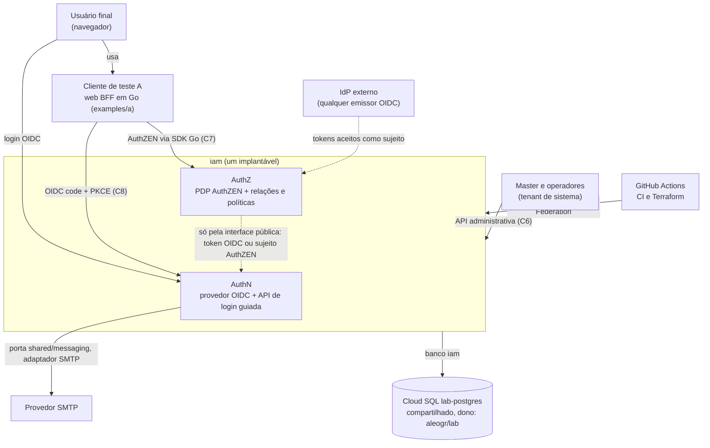

_Legenda: AuthN e AuthZ formam um único implantável; o AuthZ também funciona com um IdP externo, sem login pelo AuthN._

## 3. C4 nível 2: containers no laboratório

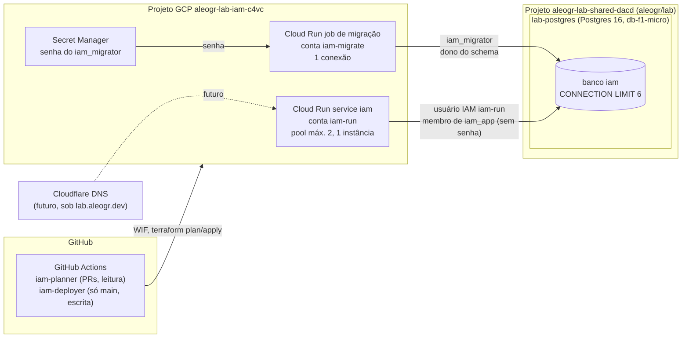

_Legenda: o aleogr/lab é dono da instância; o iam declara apenas o banco `iam` e os usuários `iam`/`iam_*`. A instância dorme seg–qui, 22:00–07:30 (São Paulo)._

| Identidade no banco | Tipo | Permissões |
|---|---|---|
| `iam_migrator` | Usuário com senha (Secret Manager; criado à mão, importado pelo Terraform) | Dono do schema; aplica migrações |
| `iam_app` | Role sem login | Só DML; sujeita a RLS; sem `BYPASSRLS`; não é dona das tabelas |
| `iam-run` | Usuário IAM, sem senha | Membro de `iam_app`; usado pelo serviço |

Bootstrap SQL: `REVOKE CONNECT ... FROM PUBLIC`, `GRANT CONNECT` por nome,
`CONNECTION LIMIT 6`. Contas de runtime: `iam-release`, `iam-run`, `iam-migrate`.

## 4. C4 nível 3: componentes do binário (marco 1)

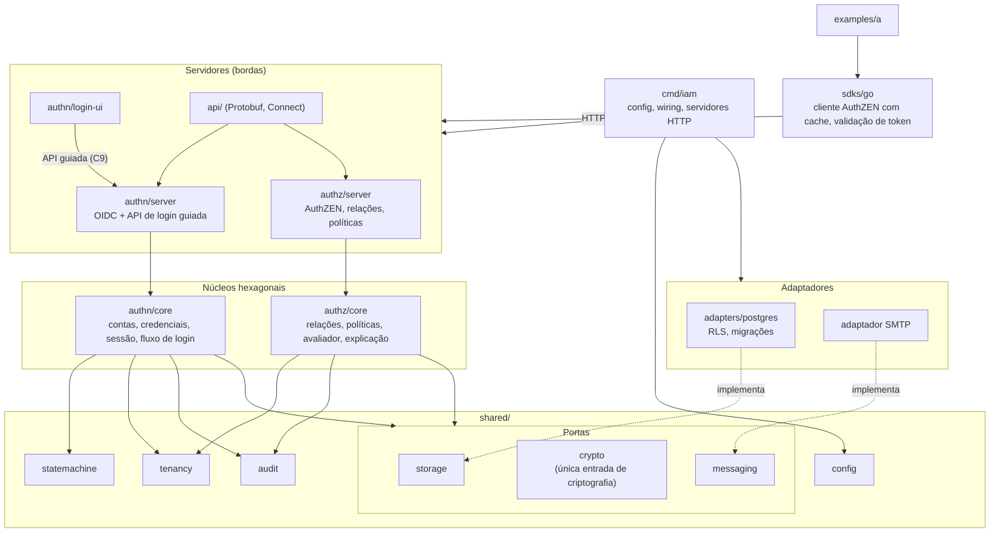

_Legenda: setas cheias são dependências permitidas; tracejadas, implementação de porta. Nenhuma seta sai de um núcleo para servidor ou adaptador._

| Regra de dependência | Consequência |
|---|---|
| Núcleos dependem só de portas e de bibliotecas puras de `shared/` | `authn/core` e `authz/core` não conhecem HTTP, banco nem nuvem |
| Adaptadores implementam portas | `adapters/postgres` implementa `shared/storage`; SMTP implementa `shared/messaging` |
| `shared/crypto` é a única entrada de criptografia | Hash de senha, JOSE (`go-jose`), aleatoriedade, comparação em tempo constante |
| AuthZ consome o AuthN só pela interface pública | Token OIDC ou sujeito AuthZEN; nada de importar `authn/core` |
| `examples/` só usa APIs públicas | Módulo separado, sem acesso a `internal` |

Módulos publicáveis com `go.mod` próprio: `authn/core`, `authz/core`,
`shared/statemachine`, SDKs Go; `go.work` na raiz. A divisão exata é decisão de
implementação no marco 0.

## 5. Fronteiras verificadas no CI

| Regra | Verificação |
|---|---|
| Núcleos não importam servidores, adaptadores, HTTP, SQL nem SDK de nuvem | `depguard` |
| Primitivas criptográficas, `go-jose` e `crypto/*` só em `shared/crypto` | `depguard` + `forbidigo` |
| Aleatoriedade só via `crypto/rand`; relógio e aleatoriedade injetados nos núcleos | `forbidigo` (`time.Now`, `math/rand` fora de adaptadores) |
| Projetos de teste (`examples/`) só usam APIs públicas | Módulo separado sem acesso a pacotes `internal` |
| Toda consulta passa pelo escopo de tenant | Porta de armazenamento exige `TenantID`; testes de abuso entre tenants |

## 6. Hierarquia de tenants

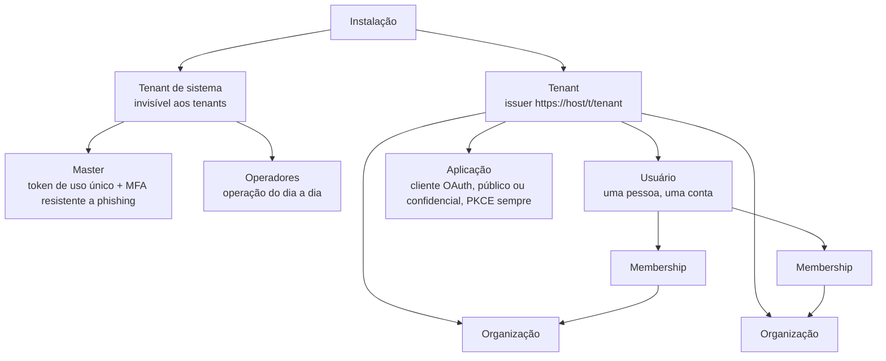

_Legenda: o usuário pertence ao tenant e entra em várias organizações por memberships; papéis por organização são relações no AuthZ._

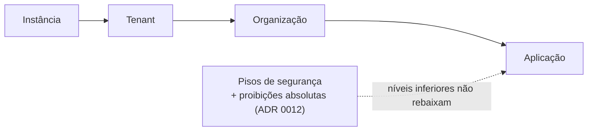

_Legenda: herança de configuração; cada nível pode endurecer, nunca rebaixar os pisos; alertas exigem ciência registrada e há modo estrito._

## 7. Fluxos

### 7.1 Login OIDC (authorization code + PKCE) com senha ou passkey

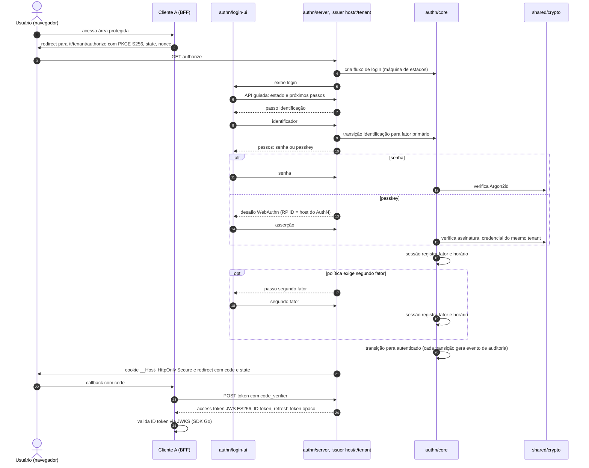

_Legenda: marco 1. O servidor valida cada transição; não há como chegar a "autenticado" sem os fatores exigidos._

### 7.2 Decisão AuthZEN do cliente A

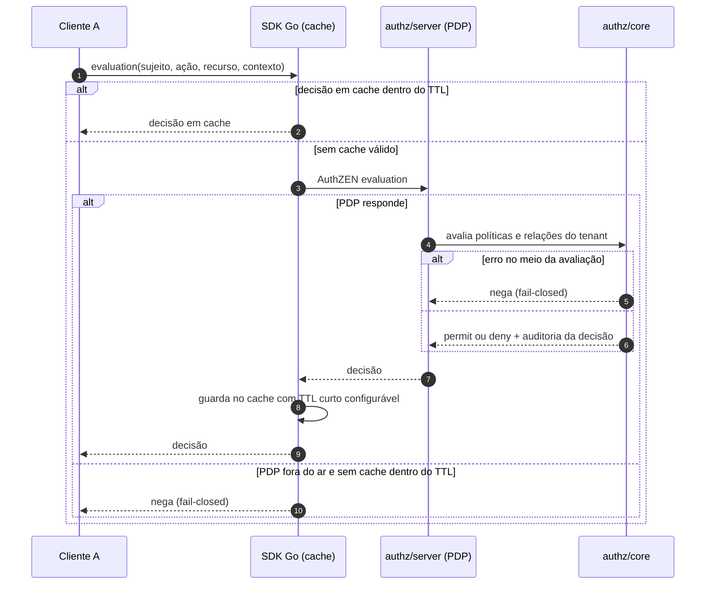

_Legenda: marco 1 (avaliação individual e em lote, cache de decisões). Avaliação local no SDK fica para o marco 2._

### 7.3 Escrita de relação com outbox e token de consistência

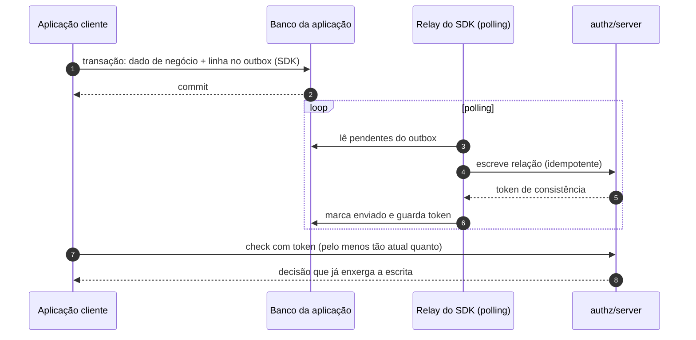

_Legenda: marco 2 (ADR 0016). Tokens de consistência servem às revogações sensíveis; no resto, consistência eventual configurável._

### 7.4 Aprovação M de N

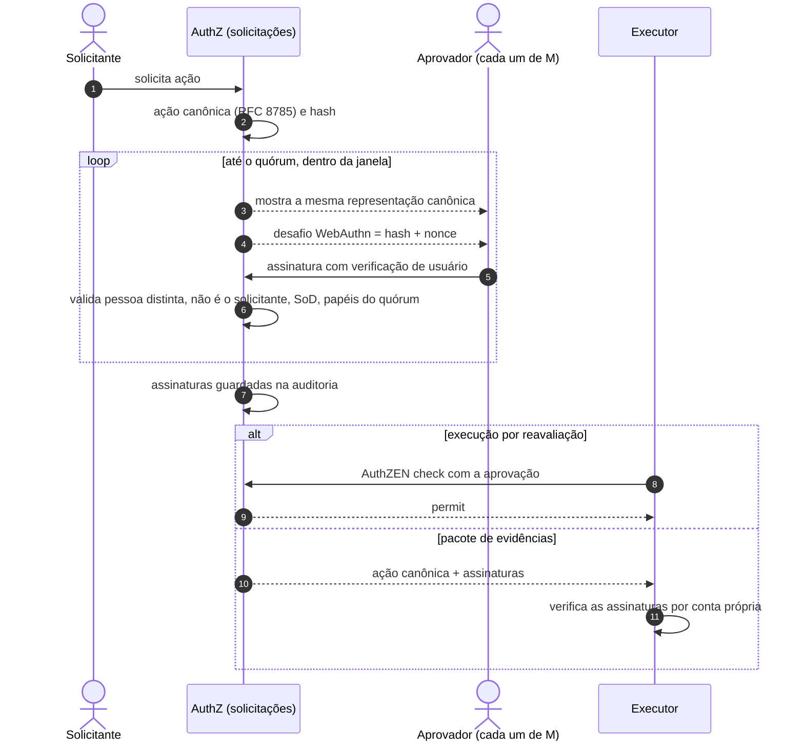

_Legenda: camada posterior, fora do marco 1 (ADR 0021)._

## 8. Máquinas de estados

Na implementação estes diagramas serão gerados a partir das definições das
máquinas de estados no código (brief 4.4); aqui está o design pretendido.
Transições não previstas são recusadas; cada transição usa versão otimista e
gera evento de auditoria.

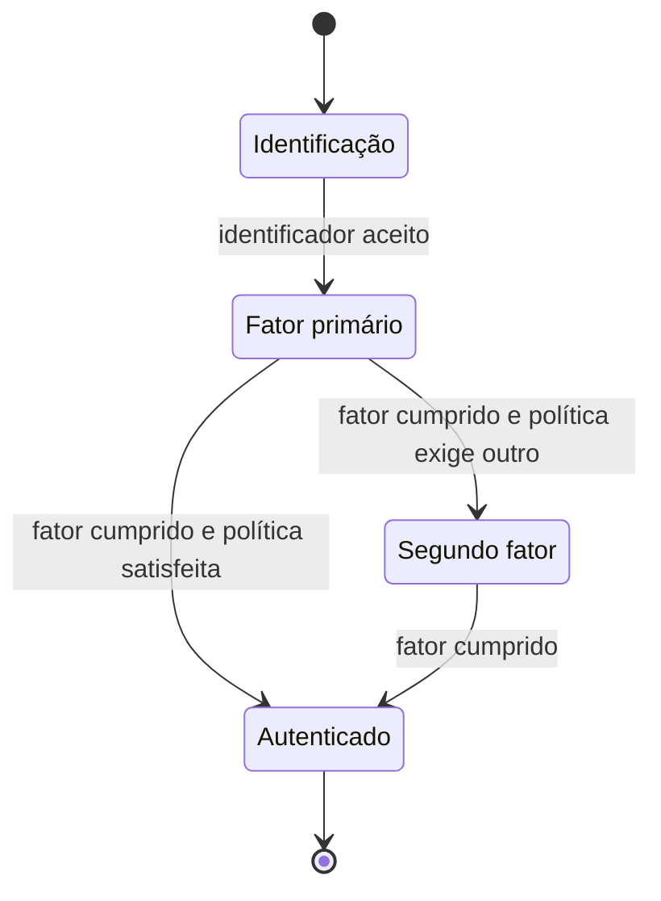

_Legenda: fluxo de login (marco 1); não existe transição que pule etapas._

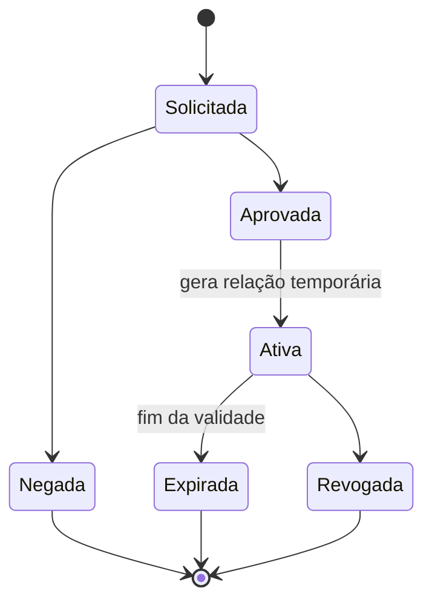

_Legenda: ciclo de vida da solicitação de acesso; camada posterior (ADR 0020)._

## 9. Dados

PostgreSQL 16 (`lab-postgres`), driver `pgx`. Sem Redis: sessões, rate limiting
e filas no Postgres. Migrações nomeadas por data e hora, sempre expand/contract,
aplicadas pelo job como `iam_migrator`.

| Módulo | Tabelas principais (nomes indicativos) | Escopo |
|---|---|---|
| `shared/tenancy` | tenants, organizações, usuários, memberships, aplicações | `tenant_id` |
| `shared/config` | configuração por nível (instância, tenant, organização, aplicação), cientes de alertas | `tenant_id` |
| `shared/audit` | eventos de auditoria encadeados por hash, só inclusão | `tenant_id` |
| `shared/statemachine` | instâncias de fluxo com estado e versão | `tenant_id` |
| `authn` | credenciais (senha, passkey), sessões com fatores e horários, códigos de autorização, refresh tokens, rate limiting | `tenant_id` |
| `authz` | relações, versões de políticas, decisões auditadas | `tenant_id` |

- Isolamento na camada de aplicação (porta exige `TenantID`), com **RLS como segunda barreira**.
- `iam_app` não é dono das tabelas e não tem `BYPASSRLS`.
- Nada de `LISTEN/NOTIFY` nem conexão dedicada; filas e outbox por polling;
  pool esgotado espera com timeout, nunca abre conexão extra.

| Consumidor | Conexões |
|---|---|
| Serviço: pool 2 × 1 instância × 2 revisões no rollout | 4 |
| Job de migração | 1 |
| Uma pessoa no psql | 1 |
| Tarefas agendadas (usam o pool do serviço via endpoint) | 0 |
| **Total (teto, com teste que falha acima disso)** | **6** |

## 10. Contratos

Versionados, cobertos por testes de contrato, alterados só por mudança
explícita e revisada.

| Contrato | Forma | Libera em paralelo |
|---|---|---|
| C1. Esquema de configuração | Tipos Go + validação + documentação gerada | Todos os módulos que leem configuração |
| C2. Porta de criptografia | Interface Go em `shared/crypto` | Senhas, tokens, chaves, passkeys |
| C3. Portas de armazenamento + suíte de contrato | Interfaces Go por domínio + testes de contrato | Adaptador Postgres × núcleos; abuso entre tenants |
| C4. Evento de auditoria | Esquema versionado | Auditoria × todos os emissores |
| C5. Biblioteca de máquinas de estados | API Go | Fluxo de login, sessão, solicitações |
| C6. API administrativa | Protobuf (`api/`), `buf breaking` | Servidor × console × SDKs gerados |
| C7. AuthZEN | Especificação 1.0 + esquema JSON | `authz/server` × SDK Go × cliente A |
| C8. OIDC do AuthN | Especificação OIDC + discovery | `authn/server` × cliente A × SDK |
| C9. API de login guiada | Esquema de estado e passos | `authn/server` × `login-ui` × futuros apps nativos |
| C10. Linguagem de políticas e modelo de relações | Gramática + esquema JSON + corpus de testes | Avaliador × oráculo × SDK |

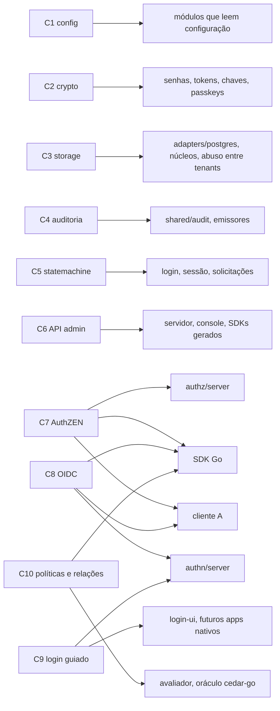

_Legenda: cada contrato fixado libera, em paralelo, as frentes que ficam dos dois lados dele._
