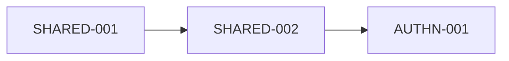

# BRIEF

## 0. Sobre este documento

Contexto consolidado de uma conversa de concepção. Nada aqui está escrito em pedra.

Legenda das marcações:
- **[PREMISSA]**: requisito meu. Guia a avaliação de todo o resto, mas pode ser questionado se houver conflito entre premissas.
- **[DECIDIDO]**: confirmado por mim. Pode ser rediscutido, mas só com motivo forte.
- **[PREFERÊNCIA]**: escolha que manifestei; aberta a argumentos.
- **[BOA PRÁTICA]**: recomendação baseada em RFCs, OWASP ou NIST. Aberta à discussão, mas qualquer alternativa precisa de justificativa de segurança equivalente ou melhor.
- **[PARA DISCUSSÃO]**: proposta surgida na conversa. Avaliar, refinar ou substituir.
- **[ABERTO]**: pergunta ainda sem proposta.

### 0.1 Terminologia e nomes

- **[DECIDIDO]** **AuthN** para autenticação e **AuthZ** para autorização. **IDaaS** para a versão gerenciada do produto de autenticação. Evitar "AaaS", que é ambíguo.
- **[DECIDIDO]** Nomes definitivos da plataforma e dos produtos serão escolhidos antes da primeira versão. Candidatos na seção 10.
- **[PARA DISCUSSÃO]** Nome provisório do repositório e do caminho de importação: `iam` (identity and access management), neutro e cobrindo os dois produtos. Neste documento, os produtos são chamados de **AuthN** e **AuthZ**, e o conjunto, de **plataforma**.
- **[PREFERÊNCIA]** Nomes de marca fora do código: diretórios, pacotes e identificadores usam nomes funcionais (`authn/`, `authz/`, `core/`...); o nome dos produtos aparece só em configuração, textos de interface e documentação.

## 1. Visão geral

A plataforma é uma solução de gestão de identidade e acesso composta por **dois produtos irmãos**:
- **AuthN:** autenticação, gestão de usuários, sessões e tokens;
- **AuthZ:** autorização, desde papéis simples até autorização fina dos recursos das aplicações.

Os dois funcionam juntos ou separados. Ambos são open source por concepção, com possível monetização futura, e vivem no mesmo monorepo.

A plataforma será usada primeiro pelos meus próprios sistemas (projetos clientes A, B, C...), que podem ter exigências muito diferentes entre si. Ela faz parte de uma infraestrutura compartilhada (identidade, autorização, envio de e-mail e outros serviços) que deve existir antes dos projetos clientes, para que eles não precisem reimplementar nada disso.

Todo o código será escrito por agentes (Claude Code). Eu opero, defino e aprovo; nenhum humano escreve código.

## 2. Premissas

Todas as premissas valem para os dois produtos.

1. **[PREMISSA] Solução completa e abrangente.**
   - **AuthN:** todos os modelos de uso (biblioteca, serviço, proxy, federação), todos os métodos de autenticação e MFA (senha, sem senha, links mágicos, passkeys, chaves físicas como YubiKey, TOTP, códigos por e-mail, SMS e WhatsApp, login social com Google, Microsoft, Apple, Facebook etc., SSO corporativo com SAML e OIDC, LDAP/AD, certificado digital ICP-Brasil).
   - **AuthZ:** todos os modelos de autorização (RBAC, ABAC, ReBAC, PBAC), padrões e capacidades da seção 5.2.
   - É o destino, alcançado em camadas, cada uma pronta, testada e auditada antes da próxima.
2. **[PREMISSA] Segurança inegociável.** Padrões seguros por definição, padrões abertos em vez de protocolos próprios, nenhuma criptografia própria, métodos de autenticação classificados por nível de garantia.
3. **[PREMISSA] Composabilidade total.** Cada aplicação e organização cliente declara, por configuração, qualquer combinação de métodos, fatores, políticas de sessão, de tokens e de autorização. Atender um novo cliente é questão de configuração, não de código.
4. **[PREMISSA] Alertar em vez de bloquear.** Configurações fracas geram alertas; quem opera decide.
5. **[PREMISSA] Altamente auditável**, nos dois sentidos: o que acontece no sistema e o próprio software.
6. **[PREMISSA] Altamente testável.**
7. **[PREMISSA] Conformidade regulatória desde o início:** LGPD e GDPR como base, mais as regulações da seção 7.
8. **[PREMISSA] Interoperabilidade:** consumível por qualquer linguagem e plataforma via padrões abertos e SDKs. O AuthZ funciona também com provedores de identidade de terceiros.
9. **[PREMISSA] Agnóstico de infraestrutura:** banco, mensagens, chaves etc. como componentes substituíveis.
10. **[PREMISSA] Suporte a clientes multi-tenant:** um projeto cliente pode ser ele mesmo uma plataforma multi-tenant (seção 4.7).
11. **[PREMISSA] Open source por concepção, com possibilidade de monetização.**
12. **[PREMISSA] Uso próprio primeiro, como um usuário externo:** os projetos clientes consomem a plataforma somente pela interface pública.
13. **[PREMISSA] Plataforma antes dos produtos clientes:** a infraestrutura compartilhada vem antes dos projetos clientes.
14. **[PREMISSA] Desenvolvido integralmente por agentes de IA:** verificações automatizadas como principal mecanismo de revisão; decisões registradas para manter consistência entre sessões.
15. **[PREMISSA] Clientes multiplataforma:** web, desktop (Windows e Linux) e mobile (Android e iOS).
16. **[PREMISSA] Testes de segurança ofensivos contínuos** durante todo o desenvolvimento, não apenas no fim.
17. **[PREMISSA] Resiliência por design, com custo mínimo no início.** A plataforma não pode ficar fora do ar quando for usada por software de terceiros, mas os custos de nuvem devem ser mínimos enquanto o projeto não gera receita. A arquitetura deve estar pronta para alta disponibilidade, e a infraestrutura deve crescer por estágios.
18. **[PREMISSA] Altamente parametrizável, nada fixo no código, em todos os níveis:** para mim (dono da solução) e para os clientes (políticas, limites, timeouts, templates, textos, branding, provedores, recursos), e também no código, na documentação, no desenvolvimento e na infraestrutura (nomes, domínios, regiões, provedores, ambientes).
19. **[PREMISSA] Portabilidade entre provedores de nuvem:** uso GCP hoje, mas devo poder migrar para AWS ou outro provedor sem reescrever o sistema.
20. **[PREMISSA] Altamente administrável.** Sempre que couber, há interface administrativa. Como dono da solução, tenho um painel para observar o uso da plataforma por todos os seus clientes.
21. **[PREMISSA] Família de produtos:** AuthN e AuthZ são produtos irmãos, que funcionam juntos ou separados, com o mesmo nível de completude, flexibilidade e exigência.
22. **[PREMISSA] Alto desempenho em todos os componentes,** com orçamentos de latência definidos por operação e verificados continuamente.
23. **[PREMISSA] Qualidade de software:** legibilidade e clareza, simplicidade, manutenibilidade, baixo acoplamento e alta coesão, ausência de duplicação, testabilidade, padronização, eficiência e bom desempenho.
24. **[PREMISSA] Mínimo de dependências de terceiros:** sempre que possível, implementar as funcionalidades; adicionar dependências apenas quando a implementação própria for inviável ou fugir do escopo (com a exceção de segurança da seção 4.30).
25. **[PREMISSA] Internacionalização:** interfaces (operador, tenants, organizações e usuários finais) em inglês por padrão, preparadas para N idiomas.
26. **[PREMISSA] Observar sempre as referências da OWASP** em design, implementação, testes e processo.

## 3. Cenários de exemplo (para orientar o design)

- **Projeto A:** um SaaS multi-tenant (por exemplo, gestão de clínicas). Cada clínica é um cliente do A.
  - A Clínica X exige SSO com o Microsoft Entra da empresa e chave física como MFA.
  - A Clínica Y usa senha com TOTP.
  - A Dra. Ana trabalha nas duas: uma única conta, papéis diferentes em cada clínica, e a política de cada clínica se aplica quando ela entra nela.
  - Cada clínica tem administradores próprios.
  - **AuthZ:** na Clínica X, a Dra. Ana só vê os prontuários dos pacientes que atende; a recepção vê a agenda, mas nenhum prontuário; um médico pode compartilhar um prontuário com outro por tempo limitado; um prontuário em rascunho pode ser editado, mas depois de assinado só aceita adendos; o acesso emergencial a um prontuário exige aprovação de duas pessoas.
- **Projeto B:** um produto B2C (por exemplo, loja online), com exigências próprias de sessão e de tokens.
- **Variação do A:** autenticação primária sem senha e MFA por OTP.
- **Uso separado do AuthZ:** uma empresa que usa Keycloak (ou outro provedor) para login usa apenas o AuthZ para autorização.
- A e B podem estar escritos em linguagens diferentes (por exemplo, Go e Rust).

## 4. Pontos de design

Salvo indicação, valem para os dois produtos.

### 4.1 Repositório e organização

- **[DECIDIDO] Monorepo** para a plataforma (AuthN, AuthZ e serviços compartilhados), numa organização própria no GitHub. A intenção é não migrar para vários repositórios no futuro.
- **[PARA DISCUSSÃO]** Cada componente com seu próprio `go.mod`, para que quem importa só uma biblioteca não herde dependências de servidores; `go.work` para desenvolvimento local.
- **[PARA DISCUSSÃO]** Fronteiras entre componentes verificadas no CI (por exemplo, com `depguard`): núcleos nunca importam servidores, proxy ou adaptadores; SDKs de nuvem só dentro de adaptadores; primitivas criptográficas só na camada criptográfica (seção 4.10).
- **[PARA DISCUSSÃO]** Código com licença diferente (recursos pagos, se existirem) num repositório privado separado desde o primeiro dia.
- **[PARA DISCUSSÃO]** Projetos clientes (A, B...) em repositórios próprios.
- **[PARA DISCUSSÃO]** Caminho de importação personalizado (vanity import path), desvinculado do GitHub.
- **[PARA DISCUSSÃO]** `CODEOWNERS` por diretório; workflows de CI acionados por caminho.
- **[PARA DISCUSSÃO]** Migrações de banco nomeadas por data e hora (evita colisões entre agentes em paralelo).
- **[PARA DISCUSSÃO]** Estrutura inicial possível:

```
iam/
├── authn/
│   ├── core/          # núcleo de autenticação
│   ├── server/        # provedor OIDC/OAuth (modo serviço), inclui federação
│   ├── proxy/         # modo proxy
│   └── login-ui/      # telas de login, cadastro e recuperação
├── authz/
│   ├── core/          # núcleo de autorização
│   └── server/        # ponto de decisão (PDP), API AuthZEN
├── shared/            # tenancy, auditoria, configuração, camada criptográfica, chaves,
│                      # máquinas de estados, observabilidade
├── adapters/          # Postgres, SMTP, KMS, armazenamento, motores de AuthZ...
├── notifications/     # serviço de envio (e-mail; depois SMS, WhatsApp, push)
├── console/           # painéis do operador, do tenant e da organização
├── api/               # definições de API
├── sdks/              # SDKs gerados por linguagem
├── examples/          # clientes de exemplo por plataforma (seção 4.20)
├── e2e/               # cenários, fluxos, conformidade, carga, falhas
├── dev/               # ambiente local completo
├── deploy/            # containers, Helm charts, módulos Terraform, pipeline de release
└── docs/              # brief, ADRs, arquitetura, roadmap, ameaças, estudo de mercado
```

### 4.2 Versionamento e ciclo de vida

- **[DECIDIDO] Versionamento híbrido:** componentes de produto compartilham uma versão de produto; SDKs têm versões próprias e seguem a versão da API (v1, v2), não a do servidor.
- **[ABERTO]** Com dois produtos: uma versão única da plataforma ou uma versão por produto (AuthN e AuthZ)?
- **[PARA DISCUSSÃO]** A versão única simplifica releases (por exemplo, permitiria usar o GoReleaser gratuito com uma configuração na raiz). Versões independentes por produto exigiriam GoReleaser Pro, um contorno frágil ou um pipeline próprio (recomendado na seção 4.18, que funciona com qualquer estratégia).
- **[PARA DISCUSSÃO]** Tags prefixadas por componente quando necessário (por exemplo `authn/core/v1.4.0`), suportadas nativamente pelo Go.
- **[PARA DISCUSSÃO]** release-please para gerar tags e changelogs por componente.
- **[PARA DISCUSSÃO]** Política de suporte declarada: quantas versões recebem correções de segurança e por quanto tempo uma versão de API obsoleta permanece disponível (também relevante para o Cyber Resilience Act).

### 4.3 Linguagens e consumo

- **[PREFERÊNCIA]** Go como linguagem principal (núcleos e servidores). Também uso Rust, e outras linguagens virão.
- **[PARA DISCUSSÃO]** Outras linguagens consomem a plataforma como serviço: via OIDC com bibliotecas cliente padrão, via AuthZEN para autorização, e via SDKs gerados a partir das definições da API para as funções administrativas. O modo biblioteca existiria apenas para Go.
- **[PARA DISCUSSÃO]** Não reimplementar núcleos em outra linguagem nem usar pontes FFI (Go chamado a partir de Rust, por exemplo), pelo risco de duplicar a superfície de bugs em código de segurança.
- **[PARA DISCUSSÃO]** Protobuf/gRPC com `buf` para as APIs administrativas (geração de clientes multilinguagem e detecção de mudanças incompatíveis). Avaliar convivência com OpenAPI/REST.
- **[PARA DISCUSSÃO]** Durante o desenvolvimento, projetos clientes apontam para cópias locais (`go.work` em Go, `[patch]` ou `path` no Cargo em Rust).

### 4.4 Arquitetura

- **[PARA DISCUSSÃO]** Núcleos em arquitetura hexagonal (portas e adaptadores): não sabem se rodam embutidos num app, como servidor ou atrás de um proxy.
- **[PARA DISCUSSÃO]** Modos de uso do AuthN em volta do núcleo:
  - **biblioteca:** o núcleo importado num app Go;
  - **serviço:** provedor OIDC/OAuth 2.1;
  - **proxy:** componente fino na frente de aplicações;
  - **federação:** o núcleo como cliente de provedores externos (Google, Microsoft, Apple, gov.br etc.).
- **[PARA DISCUSSÃO]** Serviços compartilhados entre os produtos (tenancy, auditoria, configuração, camada criptográfica, gestão de chaves, máquinas de estados, observabilidade, notificações), evitando duplicação.
- **[PARA DISCUSSÃO]** Métodos de autenticação como módulos plugáveis atrás de uma interface comum de "autenticador".
- **[PARA DISCUSSÃO]** Relógio e gerador de aleatoriedade injetados como dependências (testes determinísticos de expiração, TOTP, bloqueios).
- **[PARA DISCUSSÃO]** Envio de mensagens como interface com pelo menos dois adaptadores: um que chama o serviço de notificações e outro que envia direto via SMTP (para quem usa só a biblioteca).
- **[PARA DISCUSSÃO]** Serviço de e-mail como camada sobre provedores (SMTP, Amazon SES, Postmark etc.), com templates, filas, tentativas e registro, e **não** como servidor de e-mail próprio, por causa da entregabilidade.
- **[PARA DISCUSSÃO]** **Monólito modular:** componentes separados no código, mas implantáveis juntos como um único binário no início (reduz custo) e separáveis depois.
- **[PARA DISCUSSÃO]** Extensões por adaptadores compilados junto, não por plugins carregados em tempo de execução (o pacote `plugin` do Go não funciona no Windows e exige versões idênticas de compilação). Plugins fora do processo via gRPC podem servir para extensões fora do caminho crítico.
- **[PARA DISCUSSÃO]** PostgreSQL como banco principal (seção 4.8).
- **[ABERTO]** Event sourcing nos núcleos (como o Zitadel) ou modelo de estado tradicional com log de auditoria separado.

**Máquinas de estados**
- **[PARA DISCUSSÃO]** Máquinas de estados explícitas como padrão de design para fluxos e ciclos de vida: fluxos de autenticação, conta, convite, sessão, código de dispositivo, token, chave, tenant, solicitações de aprovação. Tabela de transições com condições (guards); transições não previstas recusadas por definição.
- **[BOA PRÁTICA]** Toda transição de fluxo de autenticação validada no servidor; impossível pular etapas (por exemplo, chegar ao estado autenticado sem cumprir o MFA exigido).
- **[PARA DISCUSSÃO]** Estado persistido com controle de concorrência (versão otimista), evitando condições de corrida (aprovações simultâneas, reutilização de OTP).
- **[PARA DISCUSSÃO]** Cada transição gera um evento de auditoria.
- **[PARA DISCUSSÃO]** Diagramas de estados gerados a partir das definições no código, mantendo documentação e implementação sempre alinhadas.

### 4.5 Configuração, políticas e parametrização

- **[PARA DISCUSSÃO]** Hierarquia de configuração com herança: instância → tenant → organização → aplicação → ação específica.
- **[PARA DISCUSSÃO]** **Pisos de segurança:** um nível superior impõe mínimos que níveis inferiores não conseguem rebaixar.
- **[PARA DISCUSSÃO]** Autenticação como fluxos compostos por etapas (identificação, fator primário, segundo fator, consentimento...), montados por aplicação e implementados como máquinas de estados. Referências: authentication flows do Keycloak, flows e stages do Authentik.
- **[PARA DISCUSSÃO]** Políticas declarativas e versionadas, gerenciáveis por API e por arquivos, revisáveis e auditáveis. Cobrem métodos primários, MFA (obrigatório, opcional ou adaptativo), recuperação, duração e inatividade de sessão, vínculo a dispositivo, formato e duração de tokens, rotação de refresh tokens, DPoP etc.
- **[BOA PRÁTICA]** Negociação de exigências por padrão aberto: `acr_values` na requisição, `acr` e `amr` no token, step-up para ações sensíveis.
- **[PARA DISCUSSÃO]** A sessão central registra quais fatores foram cumpridos e quando. Ao passar para um app com exigência maior, o AuthN pede apenas o fator que falta.
- **[PARA DISCUSSÃO]** Simulação de políticas: "dado este usuário, este app e este contexto, qual fluxo seria exigido?" (e, no AuthZ, "qual seria a decisão?"), para que os projetos clientes testem suas políticas antes de aplicá-las.
- **[PARA DISCUSSÃO]** Perfis de conformidade (por exemplo "LGPD + Marco Civil", "GDPR", "PSD3", "ECA Digital") que aplicam padrões adequados e alertam sobre desvios.
- **[PARA DISCUSSÃO]** Parametrização ampla com controle de complexidade:
  - esquema de configuração tipado e validado ao carregar;
  - padrões seguros e sensatos, sem parâmetro obrigatório para começar;
  - regra clara de precedência (arquivo, variáveis de ambiente, API, hierarquia de tenants);
  - documentação gerada a partir do esquema.
- **[PARA DISCUSSÃO]** Nada fixo no código, em todos os níveis:
  - código: nomes de produto, domínios, URLs, regiões, provedores e limites vêm de configuração;
  - documentação: nomes de produto e domínios centralizados (por exemplo, variáveis do gerador de documentação), facilitando a troca de nome;
  - desenvolvimento: ambientes definidos por variáveis, sem caminhos ou contas fixos;
  - infraestrutura: módulos Terraform parametrizados por variáveis (projeto, região, domínio, estágio).

Exemplo ilustrativo de políticas de AuthN (formato a definir):

```yaml
app: projeto-a
autenticacao:
  primaria: [passkey, link_magico]
  mfa: { exigido: true, metodos: [totp] }
recuperacao:
  metodos: [codigos_recuperacao]
---
app: projeto-b
autenticacao:
  primaria: [senha, google]
  mfa: { exigido: adaptativo, metodos: [webauthn, totp] }
sessao: { duracao_maxima: 8h, inatividade: 30m, vinculo_dispositivo: true }
tokens:
  formato: opaco
  access_token_ttl: 5m
  refresh: { rotacao: true, deteccao_reuso: true }
  dpop: obrigatorio
```

### 4.6 Alertas de configuração

- **[PARA DISCUSSÃO]** Alertas com gravidade (informativo, atenção, crítico), explicação do risco, recomendação e referência (OWASP, NIST, RFC).
- **[PARA DISCUSSÃO]** Alertas críticos exigem ciência registrada (quem, quando, justificativa) no log de auditoria; a ciência expira, forçando revisão periódica.
- **[PARA DISCUSSÃO]** Painel de postura de segurança por aplicação e organização; alertas também expostos via API.
- **[PARA DISCUSSÃO]** Modo estrito opcional, que transforma alertas críticos em erros e pode ser imposto por um nível superior da hierarquia.
- **[PARA DISCUSSÃO]** Lista curta de proibições absolutas para configurações sem nenhum uso legítimo (por exemplo: tokens com `alg: none`, URIs de redirecionamento com curingas ou em HTTP fora de desenvolvimento, armazenamento reversível de senhas, master sem MFA resistente a phishing), bloqueadas mesmo com a filosofia de alertar.
- **[BOA PRÁTICA]** Padrões seguros: a configuração inicial já é segura; alertas só aparecem quando alguém se afasta dela conscientemente.
- **[BOA PRÁTICA]** Métodos classificados por nível de garantia: resistentes a phishing (WebAuthn: passkeys e chaves físicas), intermediários (TOTP, push com confirmação de número), fracos (códigos por SMS, WhatsApp e e-mail, sujeitos a SIM swap, interceptação e phishing em tempo real). Os fracos ficam disponíveis, mas desligados por padrão.

### 4.7 Multi-tenancy

- **[PARA DISCUSSÃO]** Dois níveis:
  - **tenant:** isolamento total de usuários e configurações (por exemplo, A e B como tenants separados, se não compartilharem usuários);
  - **organização:** dentro de um tenant, para os clientes de um SaaS multi-tenant (por exemplo, as clínicas do A).
- **[PARA DISCUSSÃO]** O usuário pertence ao tenant; associações (memberships) ligam o usuário a organizações, com papéis por organização. Uma pessoa, uma conta, várias organizações.
- **[PARA DISCUSSÃO]** Organizações com políticas, administradores, branding e domínios próprios (descoberta por domínio de e-mail para encaminhar ao IdP da organização).
- **[PARA DISCUSSÃO]** Possibilidade de "promover" uma organização a tenant próprio quando um cliente exigir isolamento total.
- **[PARA DISCUSSÃO]** O tenant presente em todo dado e toda consulta desde o primeiro dia. Essa parece ser a parte mais difícil de mudar depois.
- **[BOA PRÁTICA]** Isolamento entre tenants sempre aplicado na camada de aplicação, com o isolamento do banco (RLS, VPD) como segunda barreira.
- **[PARA DISCUSSÃO]** O mesmo modelo de tenants e organizações compartilhado entre AuthN e AuthZ.

### 4.8 Dados, armazenamento e soberania

- **[PARA DISCUSSÃO]** Modelos de isolamento de armazenamento e suas trocas:

| Modelo | Vantagens | Desvantagens |
|---|---|---|
| Banco compartilhado com `tenant_id` | Simples, barato | Bug de consulta pode vazar dados entre tenants |
| Schema por tenant | Melhor isolamento, backup por tenant | Migrações em muitos schemas |
| Banco por tenant | Isolamento máximo, residência por região | Caro e complexo em escala |

- **[PARA DISCUSSÃO]** Proposta: banco compartilhado com **Row-Level Security do Postgres** como padrão, e camada de acesso a dados que roteia por tenant desde o início, permitindo mover um tenant para banco dedicado ou outra região depois.
- **[PARA DISCUSSÃO]** Opções de soberania de dados, especialmente para uma futura versão gerenciada:

| Opção | Atende | Complexidade |
|---|---|---|
| Banco dedicado em região escolhida pelo cliente | Residência de dados | Baixa |
| BYOK (chaves no KMS do cliente; revogar = dados ilegíveis) | Residência e controle de acesso | Média |
| BYODB (serviço gerenciado conectado ao banco do cliente) | Residência, controle e posse | Alta |
| Implantação híbrida (cliente roda serviço e banco; plano de controle gerenciado, como o Pomerium Zero) | Residência, controle e posse | Média a alta |
| Self-hosted | Tudo, operado pelo cliente | Do cliente |

- **[PARA DISCUSSÃO]** Desafios do BYODB puro: latência (todo login consulta o banco), disponibilidade dependente do banco do cliente, migrações de schema no ambiente dele, alterações diretas no banco contornando a plataforma, conectividade privada, guarda de credenciais, e o fato de o serviço continuar lendo os dados. BYOK e implantação híbrida parecem atender a maioria dos casos com menos atrito.
- **[PARA DISCUSSÃO]** Se oferecidos como recursos pagos, cobrar pela **operação** na versão gerenciada, não pelo código: quem faz self-hosting já tem controle total do banco.
- **[PARA DISCUSSÃO]** Suporte futuro a outros bancos (por exemplo, Oracle, exigido por clientes corporativos em self-hosting):
  - portas de armazenamento orientadas ao domínio (usuários, sessões, políticas, relações, auditoria...), não uma abstração genérica de SQL nem ORM;
  - contratos explícitos em cada porta (atomicidade, isolamento, travas);
  - uma suíte de testes de contrato executada contra todos os adaptadores, incluindo os testes de abuso entre tenants;
  - migrações por banco;
  - recursos específicos do Postgres (RLS, advisory locks, `SKIP LOCKED`, JSONB) confinados ao adaptador; o Oracle tem equivalentes (VPD, `DBMS_LOCK`, `SKIP LOCKED`, tipos JSON);
  - implementar um segundo banco somente com demanda real, pelo custo permanente de testes, migrações e suporte;
  - migração entre bancos via exportação e importação de tenants no nível da aplicação (seção 4.13).

### 4.9 Gestão de chaves

- **[BOA PRÁTICA]** Chaves de assinatura com rotação publicada via JWKS.
- **[PARA DISCUSSÃO]** Chaves de cifra por tenant e por usuário (crypto-shredding, seção 4.12).
- **[PARA DISCUSSÃO]** **Cifra em envelope:** dados cifrados por chaves de dados, que por sua vez são cifradas por chaves mestras no KMS. Também facilita a portabilidade entre nuvens (seção 4.16).
- **[PARA DISCUSSÃO]** Gestão de chaves como adaptador: chaves locais (desenvolvimento), KMS de nuvem (GCP, AWS, Azure), HashiCorp Vault, HSM (clientes regulados).
- **[PARA DISCUSSÃO]** Chaves de assinatura operando dentro do KMS/HSM (mais seguro, com latência e custo por operação) ou carregadas na memória a partir do KMS (rápido e barato); configurável.

### 4.10 Criptografia

- **[BOA PRÁTICA]** TLS 1.2+ (preferencialmente 1.3) em toda comunicação, inclusive interna.
- **[BOA PRÁTICA]** Senhas com hash Argon2id, parâmetros configuráveis e novo hash no login quando os parâmetros mudarem. Hashes importados (bcrypt, PBKDF2, scrypt) aceitos e atualizados no login.
- **[PARA DISCUSSÃO]** Tokens com assinatura assimétrica (ES256, RS256 ou EdDSA, conforme compatibilidade dos clientes); JWE quando houver dados sensíveis no token.
- **[BOA PRÁTICA]** Tokens opacos, refresh tokens, códigos de recuperação, OTPs, chaves de API e client secrets guardados apenas como hash.
- **[BOA PRÁTICA]** Sementes TOTP e segredos de integração (client secrets de provedores, senhas SMTP) cifrados em envelope.
- **[PARA DISCUSSÃO]** Dados pessoais cifrados no nível da aplicação, em envelope, com chaves por tenant e por usuário. Cifra de disco e TDE não protegem contra quem acessa o banco.
- **[PARA DISCUSSÃO]** Índices cegos (HMAC) para buscas exatas em campos cifrados, como o e-mail.
- **[PARA DISCUSSÃO]** Log de auditoria com encadeamento por hash e pontos de verificação assinados; backups cifrados com chaves separadas.
- **[PARA DISCUSSÃO]** Uma camada criptográfica central, compartilhada pelos dois produtos: todo uso de criptografia passa por um único módulo interno, pequeno e muito testado; regra no CI proíbe primitivas criptográficas fora dele.
- **[BOA PRÁTICA]** Aleatoriedade sempre via `crypto/rand` (verificável por lint); comparações em tempo constante para segredos.
- **[PARA DISCUSSÃO]** Agilidade criptográfica: todo dado cifrado e todo hash guarda o identificador do algoritmo e da versão da chave, permitindo migrações graduais.
- **[PARA DISCUSSÃO]** Preparação pós-quântica: troca de chaves híbrida no TLS (já suportada pelo Go); assinaturas de tokens pós-quânticas quando os padrões amadurecerem.
- **[PARA DISCUSSÃO]** Modo FIPS 140-3 para clientes governamentais e regulados, aproveitando o módulo criptográfico nativo das versões recentes do Go.
- **[PARA DISCUSSÃO]** Compartilhamento de segredos de Shamir e assinaturas por limiar (por exemplo, FROST, padronizado pela IETF) para operações críticas que exigem várias partes (seções 4.23 e 4.29).

### 4.11 Auditoria

- **[BOA PRÁTICA]** Log de auditoria separado dos logs operacionais.
- **[PARA DISCUSSÃO]** Eventos estruturados e versionados: quem agiu, sobre quem, o quê, quando, de onde, resultado. Na impersonação, registrar o ator e o usuário representado.
- **[PARA DISCUSSÃO]** Eventos cobertos: logins e falhas, mudanças de MFA, emissão e revogação de tokens, mudanças de configuração e de políticas, ações administrativas, acessos de suporte a dados, ciência de alertas, transições de estado, aprovações multipartes, decisões de autorização (configurável).
- **[PARA DISCUSSÃO]** Log somente de inclusão com encadeamento por hash (alterações detectáveis), e exportação contínua para destinos externos (SIEM, armazenamento imutável).
- **[PARA DISCUSSÃO]** Auditabilidade do software: builds reproduzíveis, SBOM por release, releases assinadas (Sigstore), atestados de proveniência (SLSA).

### 4.12 Privacidade (LGPD, GDPR)

- **[PARA DISCUSSÃO]** A plataforma fornece ferramentas para que quem a opera cumpra a legislação (o operador da instalação é o controlador). Numa versão gerenciada, o projeto passaria a ser operador dos dados.
- **[PARA DISCUSSÃO]** Direitos do titular como funcionalidades (autoatendimento e API): confirmação e acesso, correção, exportação, eliminação, revogação de consentimento, informação sobre compartilhamento.
- **[PARA DISCUSSÃO]** Gestão de consentimento com versão dos termos, data e finalidade.
- **[BOA PRÁTICA]** Minimização: atributos coletados configuráveis; cada app recebe só os atributos de que precisa.
- **[PARA DISCUSSÃO]** Retenção configurável, incluindo retenção mínima obrigatória onde a lei exigir (registros de acesso do Marco Civil, registros de incidentes da ANPD).
- **[BOA PRÁTICA]** Pseudonimização em logs e telemetria quando o identificador real não for necessário.
- **[PARA DISCUSSÃO]** **Crypto-shredding** para conciliar log imutável e direito à eliminação: dados pessoais cifrados com chave por usuário; eliminar = destruir a chave.
- **[PARA DISCUSSÃO]** Apoio a resposta a incidentes: detecção de anomalias e consultas rápidas do tipo "quais contas e dados foram afetados, desde quando".

### 4.13 Backup e recuperação

- **[PARA DISCUSSÃO]** Não criar plugins por fornecedor de backup. Ferramentas como Commvault e Veeam fazem backup no nível da infraestrutura e suportam PostgreSQL; se todo o estado está num Postgres padrão, qualquer ferramenta funciona (inclusive pgBackRest, WAL-G e os backups nativos dos bancos gerenciados).
- **[PARA DISCUSSÃO]** Responsabilidades da plataforma:
  - todo o estado em lugares conhecidos e documentados (banco, chaves, arquivos), nada importante em disco local;
  - procedimento de restauração documentado;
  - estratégia própria de backup para chaves (dados cifrados são inúteis sem elas).
- **[BOA PRÁTICA]** Restauração testada periodicamente de forma automatizada (restaurar numa instância temporária e verificar o funcionamento).
- **[PARA DISCUSSÃO]** **Interação entre crypto-shredding e backups:** se as chaves por usuário ficarem no mesmo banco, backups antigos as contêm, e a eliminação não alcança os backups. Opções: chaves por usuário fora do banco, num cofre com retenção curta, ou retenção dos backups limitada ao prazo de efetivação da eliminação. Resolvido isso, a eliminação vale automaticamente também para os backups.
- **[PARA DISCUSSÃO]** Funcionalidades complementares:
  - exportação e importação cifrada de um tenant inteiro (restaurar um cliente sem afetar os outros, mover para banco dedicado, migrar entre bancos, portabilidade);
  - exclusão com período de carência para usuários e tenants;
  - exportação contínua do log de auditoria.
- **[PARA DISCUSSÃO]** Uma API administrativa completa permite que ferramentas de backup de SaaS (no estilo do Keepit) façam backup da plataforma no futuro, sem plugins específicos.

### 4.14 Clientes multiplataforma

- **[BOA PRÁTICA]** Apps nativos (desktop e mobile) são clientes públicos: PKCE obrigatório, nenhum segredo embutido.
- **[BOA PRÁTICA]** Login de apps nativos pelo navegador do sistema (RFC 8252), não por webview embutida. Retorno por loopback (`127.0.0.1`) no desktop e por Universal Links / App Links (ou esquemas próprios) no mobile.
- **[BOA PRÁTICA]** Device Authorization Grant (RFC 8628) para CLIs e dispositivos com entrada limitada.
- **[BOA PRÁTICA]** Web: padrão BFF (tokens no backend, cookie `HttpOnly` no navegador); nada de tokens em `localStorage`.
- **[BOA PRÁTICA]** SDKs usam o armazenamento seguro de cada plataforma: Keychain, Android Keystore, Windows Credential Manager, Secret Service no Linux.
- **[PARA DISCUSSÃO]** Suporte limitado a passkeys de plataforma no Linux; chaves físicas USB como alternativa.
- **[PARA DISCUSSÃO]** Login nativo via API (sem navegador) como opção, com alerta quando habilitado, já que contraria a RFC 8252.
- **[PARA DISCUSSÃO]** Gestão de sessões por dispositivo, com revogação individual.
- **[PARA DISCUSSÃO]** Verificação de app genuíno (Play Integrity, App Attest) como recurso avançado.
- **[PARA DISCUSSÃO]** SDKs adicionais conforme a necessidade: TypeScript, Kotlin, Swift e possivelmente Flutter ou React Native, cobrindo AuthN e AuthZ.
- **[ABERTO]** App autenticador próprio para MFA por push e para aprovações multipartes, ou SDK mobile para os apps clientes receberem essas notificações.
- **[ABERTO]** Suporte a macOS (não mencionado nos requisitos, mas o design não deve impedi-lo).

### 4.15 Resiliência e custo

Princípio proposto: **projetar para a resiliência, implantar para o custo.** A resiliência deve vir principalmente de decisões de código; subir de estágio deve ser configuração de infraestrutura, não reescrita.

- **[BOA PRÁTICA]** Servidores sem estado; nada em memória local que impeça rodar várias instâncias.
- **[PARA DISCUSSÃO]** Tarefas de instância única (rotação de chaves, limpezas) coordenadas por travas no banco (por exemplo, advisory locks do Postgres).
- **[BOA PRÁTICA]** Health checks, readiness e desligamento gracioso.
- **[BOA PRÁTICA]** Timeouts, tentativas com backoff e circuit breakers em toda dependência externa (provedores de e-mail, IdPs de federação).
- **[PARA DISCUSSÃO]** Padrão outbox para notificações e eventos.
- **[PARA DISCUSSÃO]** Degradação planejada: aplicações clientes validam tokens localmente com as chaves públicas em cache e avaliam autorização localmente com políticas e dados em cache, continuando a funcionar se a plataforma cair. Troca a configurar por aplicação: tokens e caches mais longos aumentam a tolerância, mas atrasam o efeito de revogações.
- **[PARA DISCUSSÃO]** Começar só com Postgres (sessões, rate limiting, filas), sem Redis; adicionar depois atrás de adaptadores, se necessário.
- **[BOA PRÁTICA]** Migrações sempre compatíveis com a versão anterior (padrão expand/contract), permitindo rollback.
- **[PARA DISCUSSÃO]** Deploys graduais com rollback automático (divisão de tráfego entre versões), já que grande parte das quedas vem de mudanças, não de falta de redundância.
- **[PARA DISCUSSÃO]** Rate limiting na própria aplicação antes de precisar de proteções pagas.
- **[PARA DISCUSSÃO]** Métodos de autenticação gratuitos primeiro (passkeys, chaves físicas, TOTP, e-mail); SMS e WhatsApp, que cobram por mensagem, quando algum projeto precisar.
- **[PARA DISCUSSÃO]** Infraestrutura por estágios no GCP (verificar preços e programas de créditos atuais):

| Estágio | Quando | Infraestrutura |
|---|---|---|
| 0. Desenvolvimento | Só eu e meus projetos em teste | Cloud Run (escala até zero) + Cloud SQL na menor instância, zona única, com backups automáticos. Alternativa a avaliar: Postgres serverless (por exemplo, Neon) |
| 1. Uso próprio em produção | A e B com usuários reais | Cloud Run com instância mínima sempre ativa + Cloud SQL com recuperação para um ponto no tempo |
| 2. Primeiros clientes externos | Software de terceiros dependendo da plataforma | Cloud SQL em alta disponibilidade (standby em outra zona), réplica em outra região para desastres, Cloud Armor |
| 3. Clientes com SLA exigente | Contratos com garantia de disponibilidade | Várias regiões, possivelmente GKE, bancos dedicados por tenant |

- **[DECIDIDO]** Estágio 0 (laboratório): projeto `aleogr-lab-iam-c4vc`; o banco é inquilino da instância compartilhada `lab-postgres` do aleogr/lab, e não um Cloud SQL próprio, com teto de 6 conexões. A instância dorme de segunda a quinta, das 22:00 às 07:30. Ver [ADR 0001](adr/0001-lab-hosting.md).

- **[PARA DISCUSSÃO]** Kubernetes não seria necessário para a minha hospedagem no início (custo fixo e operação), mas Helm charts seriam um entregável do projeto para quem faz self-hosting.
- **[PARA DISCUSSÃO]** Metas explícitas por estágio: disponibilidade, perda de dados tolerada (RPO) e tempo de recuperação (RTO), para não prometer a clientes o que a infraestrutura do momento não sustenta.
- **[PARA DISCUSSÃO]** Observabilidade com OpenTelemetry, usando cotas gratuitas no início (Cloud Logging/Monitoring ou Grafana Cloud), com volume de logs controlado.

### 4.16 Infraestrutura, nuvem e portabilidade

- **[PREFERÊNCIA]** GCP como provedor atual.
- **[PREFERÊNCIA]** Terraform para infraestrutura como código. Observação: o Terraform usa licença BSL desde 2023; os módulos publicados para usuários podem ser mantidos compatíveis com o OpenTofu.
- **[PARA DISCUSSÃO]** Distinguir **portabilidade** (migrar sem reescrever; barato se pensado cedo) de **multi-cloud ativo** (rodar em várias nuvens ao mesmo tempo; caro, não é objetivo agora).
- **[PARA DISCUSSÃO]** Nenhum SDK de nuvem nos núcleos; tudo específico de provedor atrás de adaptadores (chaves, segredos, armazenamento, e-mail).
- **[PARA DISCUSSÃO]** Protocolos padrão no lugar de APIs proprietárias: PostgreSQL padrão, API do S3 para arquivos, OpenTelemetry (OTLP), SMTP como opção universal, containers OCI. Filas no Postgres em vez de Pub/Sub ou SQS.
- **[PARA DISCUSSÃO]** Cloud Run como escolha de baixo aprisionamento (containers comuns, portáveis para ECS Fargate, App Runner, Azure Container Apps ou Kubernetes).
- **[PARA DISCUSSÃO]** Módulos Terraform com interface comum por camada (banco, serviço, chaves), com implementação por nuvem. Só a do GCP agora.
- **[PARA DISCUSSÃO]** Migração de chaves: chaves em KMS de nuvem normalmente não são exportáveis. Com cifra em envelope, migrar significa recifrar só as chaves de dados com a chave mestra da nova nuvem. Chaves de assinatura migram por rotação planejada (nova chave publicada no JWKS antes da troca).
- **[PARA DISCUSSÃO]** CI rodando contra equivalentes locais (Postgres em container, MinIO, adaptador de chaves local) para garantir que nada dependa só do GCP.
- **[PARA DISCUSSÃO]** Considerar o custo de saída de dados (egress) numa migração.

### 4.17 Domínios e ambiente de desenvolvimento

- **[PREFERÊNCIA]** Ambiente de desenvolvimento num subdomínio do lab, por exemplo `identity.lab.aleogr.dev`. O domínio `aleogr.dev` é meu e o subdomínio `lab.aleogr.dev`, gerenciado na Cloudflare, hospeda todos os meus projetos em desenvolvimento. Não haverá domínio próprio para o projeto no início. O registro `identity.lab.aleogr.dev` foi apagado junto com o projeto GCP anterior; o novo nome sob `lab.aleogr.dev` será escolhido quando houver serviço publicado.
- **[BOA PRÁTICA]** Nenhum domínio fixo no código: issuer OIDC, RP ID do WebAuthn, domínios de cookies, URIs de redirecionamento e links de e-mail vêm de configuração.
- **[PARA DISCUSSÃO]** Passkeys ficam presas ao RP ID: as registradas no domínio do lab não funcionam no domínio definitivo. Quando houver usuários reais, o AuthN deve estar no domínio definitivo.
- **[BOA PRÁTICA]** RP ID o mais restrito possível (o subdomínio do AuthN), nunca `aleogr.dev`, que permitiria a qualquer projeto do lab solicitar as passkeys.
- **[BOA PRÁTICA]** Todos os subdomínios de `aleogr.dev` são o mesmo site para os navegadores: cookies restritos ao host com prefixo `__Host-`; proteção anti-CSRF própria (tokens e verificação de `Origin`), sem depender só de `SameSite`.
- **[BOA PRÁTICA]** Remover registros DNS de projetos desativados (risco de tomada de subdomínio); incluir isso no processo e no Terraform.
- **[BOA PRÁTICA]** Atrás da Cloudflare: configuração de proxies confiáveis, aceitando `CF-Connecting-IP` só de requisições vindas da Cloudflare (rate limiting e auditoria dependem do IP real).
- **[BOA PRÁTICA]** `Cache-Control: no-store` em respostas de autenticação; nenhuma regra de cache da Cloudflare nesses caminhos; desligar otimizações que reescrevem HTML ou scripts nas telas de login.
- **[PARA DISCUSSÃO]** Restringir o acesso ao ambiente do lab, ao menos aos painéis administrativos (por exemplo, Cloudflare Access). Nunca usar dados pessoais reais no lab.
- **[PARA DISCUSSÃO]** SPF, DKIM e DMARC no domínio de envio, com um subdomínio de envio por projeto para isolar a reputação.
- **[PARA DISCUSSÃO]** Domínios próprios por tenant ou organização no futuro (por exemplo, `login.clinicax.com.br`), com certificados automáticos; candidato a recurso pago.
- **[ABERTO]** Issuer por tenant por caminho ou por subdomínio.

### 4.18 CI/CD (GitHub Actions)

- **[PARA DISCUSSÃO]** CI em cada pull request:
  - jobs por componente, acionados por caminho;
  - formatação, lint (seção 4.30), `go vet`, regras de fronteira entre módulos;
  - testes de unidade com detector de condições de corrida;
  - integração com Postgres real em container;
  - fuzzing curto, com rodadas longas noturnas;
  - benchmarks com detecção de regressão (seção 4.21);
  - `govulncheck`, `gosec`, CodeQL, detecção de segredos (gitleaks), verificação de licenças das dependências;
  - detecção de mudanças incompatíveis na API (`buf breaking`) e verificação de código gerado atualizado;
  - verificação de que diagramas gerados estão atualizados (seção 4.27);
  - build e varredura de imagens (Trivy ou Grype).
- **[PARA DISCUSSÃO]** Suítes de conformidade OIDC, WebAuthn e AuthZEN noturnas e antes de cada release.
- **[PARA DISCUSSÃO]** CD:
  - release-please para versões e changelogs;
  - pipeline de release (itens abaixo);
  - assinatura com cosign, SBOM e atestados de proveniência;
  - publicação em registro de containers, tags de módulos Go e registros de cada SDK.
- **[PARA DISCUSSÃO]** Recomendação: pipeline de release próprio (`go build` por plataforma, `syft`, `cosign`, release-please; ko para imagens; nfpm para pacotes `.deb`/`.rpm`, se necessário), em vez do GoReleaser. Motivos: não amarra a decisão de versionamento (seção 4.2; o recurso de monorepo do GoReleaser é exclusivo da versão Pro), segue as premissas de mínimo de dependências e parametrização, e é mantido pelo agente.
- **[BOA PRÁTICA]** Verificação de reprodutibilidade no CI (dois builds limpos, comparação de hashes); publicação condicionada à presença e validade de SBOM, assinaturas e checksums; release de ensaio a cada mudança no pipeline.
- **[PARA DISCUSSÃO]** Alternativa, caso o pipeline próprio se mostre custoso: GoReleaser gratuito com versão única da plataforma.
- **[PARA DISCUSSÃO]** Ambientes: homologação automática a cada merge na branch principal; produção com aprovação manual.
- **[BOA PRÁTICA]** Segurança do pipeline:
  - branch principal protegida, verificações obrigatórias, sem push direto (nem do agente);
  - actions fixadas por hash de commit, não por tag;
  - credenciais de nuvem via OIDC (Workload Identity Federation no GCP), sem segredos de longa duração. Em uso no laboratório desde 2026-11-06, com identidades separadas para `plan` (qualquer branch) e `apply` (só `main`): [ADR 0001](adr/0001-lab-hosting.md).

### 4.19 Segurança ofensiva contínua

- **[BOA PRÁTICA]** Todo documento de design inclui uma seção de modelo de ameaças.
- **[PARA DISCUSSÃO]** Cada ameaça vira um teste de abuso dentro do TDD: o teste tenta o ataque e verifica que ele falha. Exemplos:
  - `alg: none` e confusão de algoritmo;
  - tokens expirados, reutilizados ou de outro tenant;
  - manipulação de `redirect_uri`; ausência de `state`, `nonce` ou PKCE;
  - acesso entre tenants e organizações;
  - força bruta; enumeração de usuários por mensagem ou tempo de resposta; reutilização de OTP;
  - contorno do MFA pela recuperação de conta;
  - manipulação de XML assinado no SAML;
  - SSRF via URLs de metadados de federação;
  - fixação de sessão;
  - CSRF e abuso de cookies a partir de subdomínios vizinhos (seção 4.17);
  - reutilização do mecanismo de inicialização do master (seção 4.23);
  - escalada de privilégio (de usuário para administrador, de administrador de tenant para operador ou master);
  - no AuthZ: decisões inconsistentes com os dados, acesso entre tenants via políticas ou relações, abuso de delegação e de acessos temporários;
  - aprovações multipartes: autoaprovação, mesma pessoa aprovando duas vezes, reaproveitamento de aprovação para outra ação, troca da ação após a aprovação;
  - testes baseados em modelo das máquinas de estados: percorrer todas as transições válidas e tentar todas as inválidas, verificando a recusa.
- **[PARA DISCUSSÃO]** Agente "atacante" separado, que tenta quebrar o que outro agente construiu, sem ter escrito o código.
- **[PARA DISCUSSÃO]** Varredura dinâmica (por exemplo, ZAP) contra instâncias no CI e em homologação.
- **[BOA PRÁTICA]** Toda vulnerabilidade encontrada vira teste de regressão permanente.
- **[BOA PRÁTICA]** Testes apenas contra ambientes próprios (local, CI, homologação), nunca contra produção com dados reais nem contra sistemas de terceiros.
- **[BOA PRÁTICA]** Isso não substitui testes de intrusão e auditorias externas antes de produção com dados reais e antes de abrir o projeto, nem um futuro programa de bug bounty.

### 4.20 Estratégia de testes e clientes de exemplo

- **[PARA DISCUSSÃO]** Diretório `examples/` com clientes mínimos por plataforma (web BFF em Go, SPA TypeScript com BFF, CLI Rust com device flow, desktop Windows/Linux com loopback, Android e iOS com links verificados), usando AuthN e AuthZ. Funções: testes ponta a ponta, documentação viva e validação de que integrações usam só a interface pública (verificável no CI).
- **[PARA DISCUSSÃO]** Cenários de referência declarativos (tenants, organizações, aplicações, políticas, relações, estados, usuários), incluindo os cenários da seção 3, carregados pelos testes ponta a ponta. Os requisitos do brief viram testes.
- **[PARA DISCUSSÃO]** Simulação de dependências externas: servidor SMTP de teste (por exemplo, Mailpit), adaptador falso de SMS/WhatsApp, autenticadores WebAuthn virtuais via automação de navegador (por exemplo, Playwright), TOTP gerado no teste, provedor OIDC/SAML simulado, OpenLDAP em container, relógio injetado.
- **[PARA DISCUSSÃO]** Ambiente local completo com um comando (por exemplo, Docker Compose), para testes interativos durante o desenvolvimento.
- **[PARA DISCUSSÃO]** Testes periódicos em homologação contra provedores reais (Google, Microsoft, SES), com contas de teste.
- **[PARA DISCUSSÃO]** Testes de carga (por exemplo, k6) e testes de falha (por exemplo, Toxiproxy: banco fora, latência, provedor indisponível), verificando a degradação planejada.
- **[PARA DISCUSSÃO]** Monitoramento sintético em produção (login e checagem de permissão de teste periódicos).
- **[PARA DISCUSSÃO]** Divisão por custo: em cada PR, clientes sem interface em Go/Rust reproduzindo o comportamento de apps nativos; noturno e antes de releases, apps reais em emuladores Android, runners Windows e runners macOS (iOS).
- **[BOA PRÁTICA]** Pirâmide de testes: a maior parte em testes de unidade e de contrato; testes ponta a ponta em menor número, por serem mais lentos e mais instáveis.

### 4.21 Desempenho

- **[PARA DISCUSSÃO]** Orçamentos de latência (p95, p99) por operação crítica: emissão e validação de tokens, login por método, checagem de permissão, listagem de recursos autorizados.
- **[PARA DISCUSSÃO]** Benchmarks no CI com detecção de regressão; análise de perfil (`pprof`); testes de carga (seção 4.20).
- **[PARA DISCUSSÃO]** Equilíbrio consciente entre segurança e desempenho: hash de senhas (Argon2id) é lento por design e pode ser vetor de negação de serviço (mitigar com rate limiting, controle de concorrência e parâmetros calibrados); assinatura dentro do KMS adiciona latência por token.

### 4.22 Administração e observação do serviço

- **[PARA DISCUSSÃO]** Dois níveis de administração, cobrindo os dois produtos:
  - **painel do operador** (dono da solução): visão de todos os tenants;
  - **painel do tenant e da organização:** cada cliente administra o que é seu.
- **[PARA DISCUSSÃO]** Painel do operador, por tenant e consolidado:
  - uso: usuários ativos (diários e mensais), logins, checagens de autorização, chamadas de API, aplicações;
  - autenticação: métodos usados, adoção de MFA e passkeys, taxas de falha;
  - autorização: volume e latência de decisões, taxa de negações;
  - saúde: erros, latência, disponibilidade;
  - segurança: eventos suspeitos, alertas de configuração ativos, postura por tenant;
  - custos variáveis: SMS, WhatsApp e e-mail enviados por tenant.
- **[PARA DISCUSSÃO]** **Medição de uso (metering)** desde o início, base para limites, cotas e uma futura cobrança.
- **[BOA PRÁTICA]** No painel do operador, métricas agregadas ou pseudonimizadas por padrão. Acesso a dados pessoais de usuários de um tenant somente com justificativa registrada e auditada (LGPD).
- **[PARA DISCUSSÃO]** API primeiro: tudo que os painéis fazem está disponível pela API administrativa; as interfaces são construídas sobre ela.
- **[PARA DISCUSSÃO]** Provedor Terraform para a configuração da plataforma (tenants, aplicações, políticas, modelos de autorização), permitindo administração como código.
- **[PARA DISCUSSÃO]** Ações críticas da plataforma (excluir tenants, exportar dados, rotacionar chaves raiz, acessar dados pessoais de usuários de tenants) protegidas por aprovação multipartes quando houver mais de um operador, ou por atraso com janela de cancelamento enquanto houver um só (seção 4.29).

### 4.23 Usuário master e inicialização

- **[PREFERÊNCIA]** Um usuário master criado automaticamente na inicialização de cada instalação, de acesso exclusivo do dono da solução.
- **[BOA PRÁTICA]** Nenhuma credencial padrão, jamais; nenhuma senha impressa em logs.
- **[PARA DISCUSSÃO]** Criação via token de inicialização de uso único e validade curta, gravado num local que só o dono acessa (por exemplo, Secret Manager criado pelo Terraform), ou via comando de inicialização executado com acesso à infraestrutura. O mecanismo se desativa após o primeiro uso e não pode ser reativado remotamente.
- **[PARA DISCUSSÃO]** MFA resistente a phishing obrigatório no primeiro acesso (duas chaves físicas ou passkeys: principal e reserva), como item da lista de proibições absolutas (seção 4.6).
- **[PARA DISCUSSÃO]** Master num tenant de sistema, isolado dos tenants de clientes; invisível e inalcançável para administradores de tenants.
- **[BOA PRÁTICA]** Um master por ambiente (lab, homologação, produção), sem compartilhamento de credenciais.
- **[PARA DISCUSSÃO]** O master não é a conta do dia a dia: operação cotidiana por conta de operador com papéis específicos; master reservado para configuração inicial e emergências. Papéis de operador permitem acrescentar outros operadores no futuro.
- **[PARA DISCUSSÃO]** Recuperação sem porta dos fundos, com opções:
  - códigos de recuperação offline guardados fisicamente;
  - partes de Shamir (M de N) guardadas em locais ou com pessoas de confiança diferentes;
  - emissão de novo token de inicialização por quem tem acesso administrativo à infraestrutura (banco e KMS).
  Sempre auditada e com alerta.
- **[PARA DISCUSSÃO]** Enquanto houver um único operador: ações críticas com atraso e janela de cancelamento, com notificação por vários canais (protege contra sessão roubada).
- **[PARA DISCUSSÃO]** Notificação a cada login do master; sessões curtas; restrição opcional por IP; painel do operador atrás de camada extra de acesso (por exemplo, Cloudflare Access).
- **[BOA PRÁTICA]** Toda ação do master auditada.

### 4.24 Operação

- **[PARA DISCUSSÃO]** Procedimento de recuperação da própria instalação (complementa a seção 4.23).
- **[PARA DISCUSSÃO]** Importação de usuários de outros sistemas, incluindo hashes de senha; importação de papéis, políticas e relações de outros sistemas de autorização.

### 4.25 Desenvolvimento com agentes

- **[PARA DISCUSSÃO]** Decisões em ADRs; regras em `CLAUDE.md` (raiz e por componente).
- **[PREFERÊNCIA]** Contratos sempre em primeiro plano, para permitir paralelização o quanto antes.
- **[PARA DISCUSSÃO]** Contratos versionados, cobertos por testes de contrato e alterados apenas por mudanças explícitas e revisadas.
- **[PARA DISCUSSÃO]** Paralelização entre agentes (worktrees) assim que os contratos necessários existirem. A fase inicial dos núcleos (modelo de domínio, tenants, sessões, tokens, interfaces) tende a ser sequencial.
- **[PARA DISCUSSÃO]** Bons candidatos a paralelizar: estudo de mercado, métodos de autenticação como módulos, adaptadores, SDKs, documentação, testes de conformidade e, depois dos contratos, partes de AuthN e AuthZ entre si. Evitar paralelizar: modelos de domínio dos núcleos, sessões e tokens, código criptográfico.
- **[PARA DISCUSSÃO]** Toda entrega revisada por um agente que não escreveu o código, usando o checklist de qualidade da seção 4.30.
- **[PARA DISCUSSÃO]** Não paralelizar além da minha capacidade de acompanhar e aprovar.
- **[PARA DISCUSSÃO]** Para partes críticas (camada criptográfica, tokens, recuperação de conta, validação de SAML, avaliação de políticas, aprovações multipartes), planejar auditorias externas antes de produção.

### 4.26 Roadmap

- **[PREFERÊNCIA]** Roadmap bem pensado e versionado em `docs/roadmap.md`, atualizado conforme o desenvolvimento avança, cobrindo AuthN, AuthZ e serviços compartilhados.
- **[PARA DISCUSSÃO]** Formato:
  - marcos com objetivo e critério de conclusão;
  - itens com identificador estável (por exemplo, `AUTHN-001`, `AUTHZ-001`, `SHARED-001`), status, dependências e links para ADRs e PRs;
  - contratos que liberam frentes paralelas identificados explicitamente;
  - grafo de dependências em Mermaid (renderizado pelo próprio GitHub).
- **[PARA DISCUSSÃO]** O item é marcado como concluído no mesmo PR que o conclui.
- **[PARA DISCUSSÃO]** Espelhar os itens em issues e milestones do GitHub, com o arquivo do repositório como fonte da verdade.

Exemplo ilustrativo de formato:

```markdown
## Marco 1: fundação compartilhada e AuthN mínimo

| ID | Item | Status | Depende de |
|---|---|---|---|
| SHARED-001 | Modelo de tenants e organizações | ✅ | — |
| SHARED-002 | Contrato da porta de armazenamento | 🚧 | SHARED-001 |
| AUTHN-001 | Autenticador por senha | ⏳ | SHARED-002 |
```



### 4.27 Documentação visual

- **[PREFERÊNCIA]** Representações visuais (grafos, diagramas, desenhos vetoriais) sempre que ajudarem o entendimento, inclusive versionadas na documentação.
- **[PARA DISCUSSÃO]** Diagramas como código (Mermaid por padrão, renderizado pelo GitHub; D2 ou PlantUML para casos mais elaborados), revisáveis e comparáveis em diffs. Evitar imagens binárias sem fonte.
- **[PARA DISCUSSÃO]** Quando houver SVG gerado, versionar a fonte e o SVG, com verificação no CI de que o SVG está atualizado.
- **[PARA DISCUSSÃO]** Modelo C4 para a arquitetura (contexto, containers, componentes); diagramas de sequência para os fluxos de autenticação, de decisão de autorização e de aprovação multipartes; diagramas de estados gerados a partir das máquinas de estados (seção 4.4); diagrama da hierarquia de tenants e organizações.

### 4.28 Forma de trabalho

- **[PREFERÊNCIA]** Comunicação objetiva e não verbosa; detalhes apenas sob demanda.
- **[PREFERÊNCIA]** Desenvolvimento fluido. Só o Claude Code programa; o fluxo não deve ser rígido a ponto de travar ou atrasar o trabalho. Automatizar tudo o que for possível. O agente pode criar branches, abrir pull requests e tomar iniciativas.
- **[PARA DISCUSSÃO]** Merge automático de PRs com o CI verde, exceto em áreas sensíveis, que pedem minha aprovação: camada criptográfica, autenticação, sessões e tokens, avaliação de políticas de autorização, aprovações multipartes, isolamento entre tenants, pipeline de CI/CD e de release, permissões, ADRs e este brief.
- **[PREFERÊNCIA]** Idiomas:
  - código, identificadores, comentários e mensagens de commit em inglês;
  - interação comigo em português;
  - documentação versionada em português até a primeira versão do produto; a partir dela, uma versão em inglês de toda a documentação.
- **[PARA DISCUSSÃO]** Mensagens de commit no formato Conventional Commits (o release-please depende disso). Títulos de PR em inglês, no mesmo formato; descrições de PR em português.
- **[PARA DISCUSSÃO]** Checklist inicial de configuração de ambiente, por exemplo:
  - **ambiente do Claude Code:** acesso de rede aos registros necessários (proxy de módulos Go, crates.io, npm, ghcr.io, cgr.dev, Docker Hub, GitHub, APIs do GCP) e à web (para o estudo de mercado); script de configuração instalando Go, Rust, `buf`, linters etc.; disponibilidade de Docker para testes de integração com containers (e alternativa, se não houver);
  - **GCP:** projeto, **alertas de orçamento** (premissa de custo mínimo), APIs habilitadas, Workload Identity Federation para o GitHub Actions, Artifact Registry, Secret Manager, contas de serviço com privilégio mínimo;
  - **Cloudflare:** registros DNS do lab para a plataforma, token de API com escopo mínimo para o Terraform;
  - **GitHub:** organização, repositório, proteção da branch principal, configurações do Actions, variáveis e segredos.

### 4.29 Produto AuthZ (pauta de discussão)

- **[PREFERÊNCIA]** O AuthZ foi pouco discutido até aqui. Quero discuti-lo bastante no brainstorming. Os itens abaixo são ponto de partida, a ser enriquecido pelo estudo de mercado.

**Posicionamento**
- **[DECIDIDO]** Produto irmão do AuthN, na mesma plataforma e no mesmo monorepo, com as mesmas premissas. Funcionam juntos ou separados.
- **[PARA DISCUSSÃO]** Compatível com provedores de identidade externos: a identidade do usuário chega via token ou pelo próprio padrão AuthZEN, sem exigir login pelo AuthN.
- **[PARA DISCUSSÃO]** A própria plataforma como primeiro cliente: papéis administrativos (operador, administradores de tenant e organização) usando o AuthZ. Começar com RBAC simples, já atrás do contrato que a autorização completa implementará depois.
- **[PARA DISCUSSÃO]** Dois tipos de autorização a cobrir:
  - **autorização de identidade:** papéis por organização, escopos OAuth, administração delegada;
  - **autorização fina das aplicações:** decisões sobre recursos dos projetos clientes, a cada requisição.

**Padrões**
- **[PARA DISCUSSÃO]** OpenID AuthZEN Authorization API 1.0 (especificação final desde janeiro de 2026) como contrato entre aplicações e o ponto de decisão. Acompanhar os perfis em rascunho do grupo (APIs de busca, obrigações, solicitação e aprovação de acesso, mapeamento para MCP).
- **[PARA DISCUSSÃO]** Outros padrões a avaliar: OAuth Rich Authorization Requests (RFC 9396), UMA 2.0, XACML (como referência histórica), escopos OAuth.

**Modelos e capacidades** (completude do produto)
- **[PARA DISCUSSÃO]** Modelos RBAC, ABAC, ReBAC e PBAC, combináveis.
- **[PARA DISCUSSÃO]** Capacidades:
  - checagem de permissão, individual e em lote;
  - listagem: quais recursos um usuário pode acessar; quais usuários podem acessar um recurso;
  - explicabilidade: por que o acesso foi concedido ou negado;
  - simulação e testes de políticas antes de aplicá-las;
  - versionamento de políticas e implantação gradual;
  - auditoria de decisões, configurável por aplicação;
  - acessos temporários e just-in-time;
  - solicitações e aprovações de acesso;
  - aprovação multipartes (detalhada abaixo);
  - delegação;
  - obrigações (ações exigidas junto com a decisão);
  - políticas por tenant e organização, com herança;
  - autorização sensível ao estado e autorização de transições (detalhada abaixo);
  - autorização de máquinas e agentes de IA (incluindo servidores MCP);
  - interface administrativa para políticas, papéis, relações e estados.

**Aprovação multipartes (M de N)**
- **[PARA DISCUSSÃO]** Ações que só executam após aprovação de M pessoas de um grupo de N (regra das duas pessoas, controle dual, maker-checker). Possível diferencial: poucos produtos de identidade oferecem como recurso de primeira classe (confirmar no estudo de mercado).
- **[PARA DISCUSSÃO]** Fluxo: solicitação → representação canônica da ação → cada aprovador confirma com chave física ou passkey (com verificação de usuário: PIN ou biometria) → assinatura WebAuthn vinculada à ação exata → execução ao atingir o quórum dentro da janela de tempo → assinaturas guardadas na auditoria como evidência.
- **[PARA DISCUSSÃO]** Regras de quórum configuráveis: M de N; composição por papéis (por exemplo, 1 da segurança e 1 do financeiro); janela de tempo; expiração.
- **[BOA PRÁTICA]** Pessoas distintas (não apenas chaves distintas); quem solicita não aprova o próprio pedido; aprovação vinculada à ação exata (sem reaproveitamento).
- **[PARA DISCUSSÃO]** Quem executa a ação verifica as assinaturas por conta própria, sem depender só da palavra da plataforma.
- **[PARA DISCUSSÃO]** Para operações criptográficas críticas (recuperação do master, chaves raiz, restauração de backups), proteção criptográfica: compartilhamento de segredos de Shamir ou assinaturas por limiar (por exemplo, FROST).
- **[PARA DISCUSSÃO]** Caminho de emergência quando os aprovadores não estiverem disponíveis, com auditoria reforçada e alerta a todo o grupo.
- **[PARA DISCUSSÃO]** Para operador único: atraso com janela de cancelamento e notificação por vários canais nas ações críticas da plataforma.
- **[PARA DISCUSSÃO]** Casos de uso: pagamentos acima de um valor, acesso emergencial a dados sensíveis, exclusão de dados, mudanças em políticas de segurança, deploys; na plataforma, exclusão de tenants, exportação de dados, rotação de chaves raiz, acesso a dados pessoais de usuários de tenants.
- **[PARA DISCUSSÃO]** Relação com o perfil de solicitação e aprovação de acesso do AuthZEN (em rascunho).

**Estados e transições**
- **[PARA DISCUSSÃO]** Três níveis possíveis:
  1. **biblioteca interna** de máquinas de estados para fluxos e ciclos de vida da plataforma (necessária de qualquer forma; em `shared/`);
  2. **funcionalidade do AuthZ:** o cliente declara estados e transições dos seus recursos, com políticas por transição; o AuthZ responde "este usuário pode fazer a transição T neste recurso, no estado S?";
  3. **motor de workflow** que guarda e executa processos de negócio: fora do escopo (seria outro produto).
- **[PARA DISCUSSÃO]** Nível 2 numa camada posterior, depois do AuthZ básico. Possível diferencial (confirmar no estudo de mercado).
- **[PARA DISCUSSÃO]** Definição única de estados e transições, usada pelo AuthZ para autorizar e pela aplicação (via SDK) para conduzir o fluxo, evitando divergência.
- **[PARA DISCUSSÃO]** A aplicação é dona do estado e o informa a cada pedido de decisão; o AuthZ não sincroniza estados de negócio.
- **[PARA DISCUSSÃO]** Autorização sensível ao estado do recurso (por exemplo, prontuário editável em rascunho e imutável após assinado) e políticas por transição, inclusive com aprovação M de N.
- **[PARA DISCUSSÃO]** Publicar a biblioteca de máquinas de estados como módulo Go open source independente.

**Problemas difíceis a discutir**
- **[PARA DISCUSSÃO]** Consistência entre mudanças de permissão e decisões (o "new enemy problem" do Zanzibar; tokens de consistência).
- **[PARA DISCUSSÃO]** Sincronização dos dados de recursos das aplicações com o AuthZ (eventos, API, consultas sob demanda, problema da escrita dupla).
- **[PARA DISCUSSÃO]** Desempenho e avaliação local: SDKs com políticas e dados em cache, motor embutido, sidecar.
- **[BOA PRÁTICA]** Em caso de falha, negar (fail closed); a resiliência vem da avaliação local e do cache, não de liberar o acesso.
- **[BOA PRÁTICA]** Tokens leves: papéis amplos no token; permissões finas consultadas no ponto de decisão.
- **[PARA DISCUSSÃO]** Listagem eficiente em grandes volumes.
- **[PARA DISCUSSÃO]** Linguagem de políticas: própria ou existente (Cedar, Rego, a linguagem de modelagem do OpenFGA).
- **[PARA DISCUSSÃO]** Governança de políticas: quem escreve, como são revisadas, testadas e versionadas.

**Motor de decisão**
- **[PARA DISCUSSÃO]** Motor atrás de um adaptador, com o contrato AuthZEN na frente. Opções:
  - relacionais (estilo Zanzibar): OpenFGA, SpiceDB (Go, Apache 2.0; rodam como serviço com banco próprio);
  - de políticas, embutíveis como biblioteca Go: Cedar, Casbin, OPA (preservam o monólito modular e o custo baixo);
  - motor próprio (alinhado à premissa 24, mas exige cuidado redobrado por ser código crítico).
- **[ABERTO]** Motor próprio, motor existente embutido ou motor existente como serviço.

### 4.30 Qualidade de código, dependências e padrões

- **[PARA DISCUSSÃO]** Qualidades da premissa 23 registradas como regras no `CLAUDE.md` e verificadas por:
  - linters (por exemplo, `golangci-lint`) para complexidade, duplicação, tamanho de funções e estilo;
  - formatação automática obrigatória;
  - checklist de qualidade aplicado pelo agente revisor em cada entrega.
- **[PARA DISCUSSÃO]** Equilíbrio entre qualidades: simplicidade prevalece sobre abstração precoce; abstrair na terceira repetição, não na segunda.
- **[PARA DISCUSSÃO]** Política de dependências:
  - preferir a biblioteca padrão do Go e pacotes mantidos pelo time do Go (`golang.org/x/...`);
  - implementar a lógica de protocolo e de produto (fluxos OIDC, políticas, máquinas de estados, worker pools etc.);
  - **exceção de segurança:** primitivas criptográficas, hash de senhas e analisadores com armadilhas conhecidas (assinaturas XML do SAML, formatos binários do WebAuthn) usam a biblioteca padrão ou bibliotecas consolidadas e auditadas, nunca implementação própria (premissa 2);
  - toda dependência nova exige justificativa registrada e atende a critérios: manutenção ativa, licença compatível, histórico de segurança, poucas dependências transitivas;
  - revisão periódica das dependências e do SBOM (também relevante para o Cyber Resilience Act).
- **[PREFERÊNCIA]** Padrões de projeto sempre que pertinentes, em sua forma idiomática em Go, sem complexidade desnecessária. Exemplos já previstos: worker pool, pipeline, fan-out/fan-in, portas e adaptadores, strategy (autenticadores), middleware, state (máquinas de estados), outbox, circuit breaker, functional options, repository.

### 4.31 Containers

- **[PARA DISCUSSÃO]** Conteinerização como forma padrão de implantação (Cloud Run, Helm charts, ambiente local) e de distribuição para self-hosting.
- **[PARA DISCUSSÃO]** Imagens finais mínimas para binários estáticos Go. Opções de base, intercambiáveis por configuração:
  - Chainguard `static` (gratuita na tag `latest`; Catalog Starter permite cinco imagens com todas as versões);
  - Docker Hardened Images (gratuitas e open source, Apache 2.0);
  - Google distroless;
  - `scratch` (exige adicionar certificados de CA, dados de fuso horário e usuário não-root).
- **[BOA PRÁTICA]** Base fixada por digest, com atualização automática (por exemplo, Renovate) e rebuild periódico mesmo sem mudanças no código.
- **[BOA PRÁTICA]** Build em múltiplos estágios; imagem final contendo apenas o binário.
- **[BOA PRÁTICA]** Execução endurecida: usuário não-root, sistema de arquivos somente leitura, sem shell, capacidades mínimas.
- **[PARA DISCUSSÃO]** Imagens multiarquitetura (amd64 e arm64), com SBOM, assinatura cosign e varredura no CI (seção 4.18), publicadas no registro de containers do GitHub.
- **[PARA DISCUSSÃO]** Para um futuro modo FIPS, avaliar se a imagem base importa, dado que o binário é estático e usa o módulo criptográfico do Go.
- **[PARA DISCUSSÃO]** Binários para Windows distribuídos como arquivos, não como containers.

### 4.32 Site do produto

- **[PARA DISCUSSÃO]** Site público versionado no monorepo, num diretório próprio (por exemplo, `site/`), separado do `docs/` (documentos de engenharia: brief, ADRs, arquitetura, estudo de mercado).
- **[PARA DISCUSSÃO]** Dois conteúdos: documentação de usuário (guias, referência de API, exemplos, versionada por release) e site institucional (página inicial, recursos, blog).
- **[PARA DISCUSSÃO]** Nome do produto e domínios vindos de configuração central (premissa 18), facilitando a troca de nome antes da primeira versão.
- **[PARA DISCUSSÃO]** Gerador de site estático: Hugo (Go, binário único, multilíngue, alinhado à premissa 24) ou alternativas com versionamento de documentação mais pronto (Docusaurus, Astro Starlight), que trazem o ecossistema Node.
- **[PARA DISCUSSÃO]** Conteúdo gerado automaticamente: referência de API (a partir de `api/`), referência de configuração (a partir do esquema), changelogs (release-please), diagramas (seção 4.27).
- **[PARA DISCUSSÃO]** Hospedagem estática de custo zero (Cloudflare ou GitHub Pages), publicação pelo CI quando o diretório mudar, prévia por PR.
- **[PARA DISCUSSÃO]** Publicado no lab durante o desenvolvimento; público só após a decisão do nome.
- **[PARA DISCUSSÃO]** Licença do conteúdo distinta da do código (por exemplo, Creative Commons para textos); nome e logo protegidos como marca.
- **[BOA PRÁTICA]** Sem rastreadores de terceiros; métricas de acesso, se houver, respeitando a privacidade e dispensando banner de cookies.
- **[PARA DISCUSSÃO]** Idiomas: português até a primeira versão; inglês a partir dela (seção 4.28).

### 4.33 Internacionalização

- **[BOA PRÁTICA]** Nenhum texto de interface no código: catálogos de mensagens com plurais e variações gramaticais (ICU MessageFormat), por exemplo com `golang.org/x/text`.
- **[PARA DISCUSSÃO]** Escolha do idioma em camadas: preferência do usuário → `ui_locales` do OIDC → `Accept-Language` → padrão da organização ou do tenant → inglês.
- **[PARA DISCUSSÃO]** Textos personalizáveis por tenant e organização, em cada idioma.
- **[PARA DISCUSSÃO]** Cobertura de tudo que o usuário vê: telas, e-mails, SMS, WhatsApp (templates aprovados pela Meta por idioma), push, mensagens de erro.
- **[BOA PRÁTICA]** Formatos regionais (datas, números, fusos) pelo CLDR.
- **[PARA DISCUSSÃO]** Suporte a idiomas da direita para a esquerda desde o início no layout das telas.
- **[BOA PRÁTICA]** Erros de API com código estável (não traduzido) e mensagem legível traduzível.
- **[PARA DISCUSSÃO]** Pseudolocalização nos testes e verificação de traduções faltantes no CI.
- **[BOA PRÁTICA]** Normalização Unicode de nomes de usuário e senhas (PRECIS, RFC 8264 e 8265); proteção contra nomes visualmente idênticos com caracteres de alfabetos diferentes.
- **[PARA DISCUSSÃO]** Fluxo de tradução com arquivos no repositório; plataforma de tradução colaborativa no futuro, se houver contribuições da comunidade.

### 4.34 Design de APIs

- **[BOA PRÁTICA]** APIs de protocolos padronizados (OIDC, OAuth, SAML, SCIM, AuthZEN, WebAuthn) implementadas exatamente como as especificações definem.
- **[PARA DISCUSSÃO]** API administrativa com design orientado a recursos (Google AIPs): métodos padrão e personalizados, definidos em Protobuf, servidos como gRPC e HTTP/JSON (por exemplo, com Connect), com OpenAPI gerada para consumo REST.
- **[PARA DISCUSSÃO]** HATEOAS completo não compensa para APIs consumidas por SDKs gerados. A ideia é aproveitada em pontos específicos:
  - descoberta (como o `/.well-known/openid-configuration` do OIDC, estendido às APIs da plataforma);
  - paginação por cursor com links;
  - **fluxos guiados pelo servidor:** a API de login devolve o estado atual e os próximos passos (campos e ações), permitindo que qualquer cliente, inclusive apps nativos, renderize qualquer fluxo configurado sem conhecê-lo de antemão;
  - **ações permitidas:** respostas do AuthZ indicando ações e transições disponíveis para o usuário naquele recurso.
- **[PARA DISCUSSÃO]** GraphQL não recomendado como API principal (autorização por campo, cache e consultas abusivas complicam a segurança).
- **[BOA PRÁTICA]** Convenções gerais: erros no formato Problem Details (RFC 9457); versão explícita; chaves de idempotência em criações; ETags para concorrência; operações longas assíncronas com acompanhamento de status; cabeçalhos de limite de requisições.

### 4.35 OWASP

- **[PARA DISCUSSÃO]** ASVS como base de requisitos de segurança, com alvo no nível 3 (aplicações críticas), e matriz de rastreabilidade no repositório ligando cada requisito ao teste que o comprova.
- **[BOA PRÁTICA]** Documentos de design de cada funcionalidade citam os Cheat Sheets correspondentes (autenticação, sessões, armazenamento de senhas, MFA, recuperação de senha, OAuth, SAML, JWT, autorização, multi-tenancy, logs, segredos, containers, CI/CD).
- **[BOA PRÁTICA]** Top 10 e API Security Top 10 como lista mínima de verificação e insumo do modelo de ameaças.
- **[PARA DISCUSSÃO]** MASVS para os SDKs e apps de exemplo mobile.
- **[BOA PRÁTICA]** Top 10 de riscos de CI/CD aplicado ao pipeline de build e release.
- **[PARA DISCUSSÃO]** CycloneDX como formato padrão dos SBOMs.
- **[PARA DISCUSSÃO]** SAMM para avaliar a maturidade do processo de segurança, em fase posterior.
- **[PARA DISCUSSÃO]** Referências OWASP incluídas no checklist do agente revisor (seção 4.30).

## 5. Escopo funcional (o destino "completo")

A ordem das camadas é tema do roadmap.

### 5.1 AuthN

1. **Autenticação primária:** senha, sem senha (link mágico, códigos), passkeys, login social, SSO corporativo (SAML, OIDC), LDAP/AD, certificado ICP-Brasil.
2. **MFA e step-up:** TOTP, WebAuthn (chaves físicas e plataforma), push, códigos por e-mail/SMS/WhatsApp, códigos de recuperação, MFA adaptativo por risco.
3. **Ciclo de vida da conta:** cadastro, verificação, recuperação, vinculação de contas, convites, provisionamento (SCIM, just-in-time), bloqueio, exclusão, verificação de idade.
4. **Sessões e tokens:** gestão por dispositivo, revogação, rotação de refresh tokens, logout global e back-channel, DPoP.
5. **Protocolos:** OAuth 2.1, OIDC, SAML, SCIM, WebAuthn, device flow, CIBA, PAR, FAPI.
6. **Máquinas e agentes:** client credentials, contas de serviço, chaves de API, identidade de workloads, autenticação de agentes de IA.
7. **Detecção e defesa:** rate limiting, proteção contra bots e credential stuffing, senhas vazadas, anomalias.
8. **Privacidade e conformidade:** seção 4.12 e perfis de conformidade.
9. **Experiência e administração:** telas de login personalizáveis e acessíveis, internacionalização, painéis administrativos, autoatendimento, webhooks e eventos.
10. **Operação e migração:** seções 4.13, 4.15, 4.23 e 4.24.
11. **Identidade descentralizada** (verifiable credentials, carteira europeia EUDI): camada futura.

Cuidados de segurança que pedem atenção especial:
- **[BOA PRÁTICA]** A recuperação de conta não pode ser mais fraca que o MFA exigido.
- **[BOA PRÁTICA]** Vinculação automática de contas sociais por e-mail só com provedores que verificam o e-mail.
- **[BOA PRÁTICA]** Impersonação pelo suporte sempre auditada.
- **[BOA PRÁTICA]** Fluxos pouco usados recebem a mesma cobertura de testes que os principais.

Restrições práticas:
- **WhatsApp:** exige conta aprovada na API oficial da Meta e templates pré-aprovados.
- **SMS:** tem custo por envio e risco de fraude por envio em massa (SMS pumping).

### 5.2 AuthZ

1. **Modelos:** RBAC, ABAC, ReBAC, PBAC, combináveis.
2. **Decisões:** checagem individual e em lote, listagem de recursos e de usuários autorizados, explicabilidade.
3. **Políticas:** linguagem, versionamento, testes, simulação, implantação gradual, governança.
4. **Dados:** relações e atributos, sincronização com as aplicações, consistência.
5. **Acesso dinâmico:** acessos temporários e just-in-time, solicitações e aprovações, aprovação multipartes (M de N), delegação, obrigações.
6. **Estados e transições:** autorização sensível ao estado do recurso, políticas por transição, definição única compartilhada com as aplicações.
7. **Padrões:** AuthZEN e seus perfis, OAuth RAR, UMA 2.0, escopos OAuth.
8. **Máquinas e agentes:** autorização de serviços, agentes de IA e servidores MCP.
9. **Desempenho e resiliência:** avaliação local, cache, motor embutido ou serviço.
10. **Auditoria:** registro de decisões, transições e aprovações, configurável.
11. **Experiência e administração:** interface para políticas, papéis, relações e estados; SDKs; integração com IdPs externos.

## 6. Estudo de mercado

### 6.1 Objetivo

- **[PREFERÊNCIA]** Estudo completo dos principais players de AuthN e de AuthZ, em fase preliminar, para orientar escopo, design e roadmap dos dois produtos.

### 6.2 Players (lista inicial; acrescentar outros relevantes que surgirem)

**AuthN**
- **Serviço self-hosted:** Keycloak, Zitadel, Ory (Kratos, Hydra, Oathkeeper), Authentik, Authgear, Logto, Authelia, Kanidm.
- **IDaaS:** Auth0/Okta, Microsoft Entra External ID, Amazon Cognito, Clerk, WorkOS, Descope, Stytch, Frontegg, FusionAuth.
- **Biblioteca/framework:** Better Auth (que incorporou o Auth.js), SuperTokens, Django Auth, Devise, ASP.NET Identity, Spring Security. Bibliotecas Go: `zitadel/oidc`, `coreos/go-oidc`, `go-webauthn`. Rust: `openidconnect`, `webauthn-rs`.
- **Proxy:** oauth2-proxy, Pomerium, Authelia, Cloudflare Access, Google IAP.
- **BaaS:** Supabase, Firebase, Appwrite, PocketBase.

**AuthZ**
- **Motores relacionais (estilo Zanzibar):** OpenFGA, SpiceDB (AuthZed), Ory Keto, Permify.
- **Motores de políticas:** OPA, Cedar, Cerbos, Casbin.
- **Plataformas de autorização:** Permit.io, Oso, Aserto/Topaz, Amazon Verified Permissions, Auth0 FGA, WorkOS FGA.
- **Plataformas corporativas (PBAC):** PlainID, Axiomatics.
- **Autorização embutida em produtos de identidade:** Keycloak Authorization Services e equivalentes.
- **Aprovações e acesso privilegiado (referência para aprovação multipartes):** Teleport (access requests), HashiCorp Vault (control groups), gestores de acesso privilegiado das nuvens.
- **Adjacente (infraestrutura, não é o foco):** OPA Gatekeeper, Kyverno.

### 6.3 O que levantar de cada player

- funcionalidades, organizadas pelos domínios da seção 5;
- funcionalidades **exclusivas** ou diferenciais;
- o que a comunidade **elogia** e do que **se queixa**, com evidências (por exemplo: experiência de desenvolvimento, documentação, desempenho, complexidade operacional, upgrades, preços, mudanças de licença);
- histórico de segurança: security advisories e CVEs relevantes, e o que eles ensinam;
- licença e modelo de negócio (o que é aberto, o que é pago);
- stack e decisões de arquitetura notáveis;
- como tratam multi-tenancy, extensibilidade, configuração, bancos suportados e soberania de dados;
- **no AuthZ, também:** modelos suportados, linguagem de políticas, consistência, listagem, sincronização de dados, explicabilidade, testes de políticas, avaliação local, desempenho publicado, suporte ao AuthZEN;
- **verificar se são de fato diferenciais:** aprovação multipartes como recurso de primeira classe; autorização sensível ao estado e autorização de transições declarativas.

### 6.4 Fontes

- documentação oficial, changelogs e roadmaps;
- GitHub: issues e discussões mais votadas, issues abertas há mais tempo, reações;
- security advisories e bases de CVE;
- discussões da comunidade (Hacker News, Reddit, fóruns, Discord públicos) e sites de avaliação;
- comparativos publicados;
- especificações e grupos de trabalho (OpenID Foundation, IETF, FIDO Alliance).

Cuidados:
- muitos comparativos são publicados por fornecedores concorrentes; registrar o viés da fonte;
- citar cada afirmação com link e data de acesso;
- estudar funcionalidades e decisões, **nunca copiar código** de outros projetos (respeitar licenças, especialmente AGPL).

### 6.5 Entregáveis

- `docs/market-study/authn/` e `docs/market-study/authz/`, com um documento por player;
- matrizes de funcionalidades (domínios da seção 5 nas linhas, players nas colunas), uma para AuthN e uma para AuthZ;
- `docs/market-study/summary.md`: síntese com
  - funcionalidades comuns a quase todos (o "mínimo esperado");
  - diferenciais que valem considerar;
  - queixas recorrentes do mercado (oportunidades para a plataforma);
  - lições de segurança, que alimentam o modelo de ameaças;
  - implicações para o escopo, o roadmap e os pontos [PARA DISCUSSÃO] deste brief.

### 6.6 Também estudar

- OWASP ASVS e NIST SP 800-63B como referências de requisitos de segurança.
- Disponibilidade dos nomes candidatos da seção 10 (marcas, domínios, organização no GitHub, nomes de pacote), com atenção a conflitos no mercado de segurança e identidade.

## 7. Regulações a considerar

Validar com especialistas jurídicos antes de decisões de produto; várias estão recebendo normas complementares.

- **LGPD** e **GDPR** (base); **UK GDPR**; **CCPA/CPRA** e leis estaduais dos EUA.
- **ANPD, comunicação de incidentes:** 3 dias úteis a partir do conhecimento do incidente; registro de incidentes, inclusive os não comunicados, por no mínimo 5 anos.
- **Marco Civil da Internet:** guarda de registros de acesso a aplicações por 6 meses.
- **ECA Digital (Lei 15.211/2025):** em vigor desde 17/03/2026; exige verificação de idade confiável (autodeclaração vedada), com métodos a serem definidos pela ANPD. Verificação de idade como módulo plugável.
- **Assinaturas eletrônicas (Lei 14.063/2020) e ICP-Brasil:** níveis simples, avançada e qualificada, mapeáveis em níveis de garantia (`acr`).
- **Open Finance Brasil:** perfil de segurança FAPI.
- **Cyber Resilience Act (UE):** obrigações de notificação desde 11/09/2026 e conformidade plena a partir de 11/12/2027. Open source fora de contexto comercial fica fora do escopo; monetização (inclusive freemium) torna o projeto "fabricante". Existe a figura do "open source steward", com obrigações reduzidas. Verificar se sistemas de gestão de identidade e de acesso estão no Anexo III ("produtos importantes"), o que exige avaliação de conformidade mais rigorosa. Implicações para o design: SBOM, processo de tratamento de vulnerabilidades, período de suporte declarado, atualizações de segurança separadas das funcionais, mínimo de dependências.
- **PSD3/PSR (pagamentos na UE):** autenticação forte reforçada, com tendência a métodos resistentes a phishing.
- **PCI DSS** (MFA em ambientes com dados de cartão); **NIS2 e DORA** (cobram segurança de fornecedores); **HIPAA** e **FedRAMP**, se esses mercados forem alvo.
- **eIDAS 2.0:** regras para quem aceita credenciais da carteira europeia.
- **Acessibilidade:** European Accessibility Act e Lei Brasileira de Inclusão (WCAG). Atenção a CAPTCHAs visuais, tempos-limite curtos e códigos com prazo apertado nas telas de login.
- **Normas e certificações:** NIST SP 800-63, OWASP ASVS, ISO 27001, SOC 2, certificações da OpenID Foundation e da FIDO Alliance, FIPS 140-3.

## 8. Open source e monetização

- **[ABERTO]** Licença: Apache-2.0 (comum no setor, inclui concessão de patentes), MIT, AGPL-3.0 (protege contra concorrência hospedada, mas reduz adoção) ou source-available (BSL, FSL). APIs e SDKs podem ter licença mais permissiva que os servidores.
- **[ABERTO]** Modelo de monetização: open core, versões gerenciadas (IDaaS e AuthZ gerenciado), suporte. Referências: Zitadel (AGPL + licença comercial + nuvem), Ory (Apache + licença enterprise + serviço gerenciado), Authentik (MIT + recursos enterprise), Pomerium (núcleo aberto + planos de controle pagos), OpenFGA e Auth0 FGA (motor aberto + versão hospedada).
- **[PARA DISCUSSÃO]** AuthN e AuthZ adotáveis e comercializáveis separadamente.
- **[ABERTO]** Quais recursos seriam pagos: soberania de dados (seção 4.8), domínios próprios por tenant (seção 4.17), modo FIPS, suporte etc.
- **[PARA DISCUSSÃO]** CLA (não apenas DCO) caso contribuições externas sejam aceitas, para preservar a possibilidade de licenciamento comercial.
- **[PARA DISCUSSÃO]** Pontos de extensão desenhados de forma que recursos pagos futuros possam entrar sem bifurcar o código.
- **[BOA PRÁTICA]** Nunca versionar segredos, credenciais ou informações internas: todo o histórico se tornará público.
- **[BOA PRÁTICA]** Arquivos de comunidade desde o início: `SECURITY.md` (política de divulgação de vulnerabilidades), `CONTRIBUTING.md`, licença.

## 9. Questões em aberto

Prioridade para as que definem o primeiro marco:

1. O que é o projeto A e quando precisa estar rodando?
2. Quem são os usuários finais dos projetos clientes (B2C, B2B, funcionários internos)? Qual a escala esperada?
3. A e B compartilham usuários (login único) ou são tenants separados?
4. Em qual região do GCP a plataforma vai rodar? Os dados precisam ficar no Brasil? Laboratório: `us-central1`, a região da instância compartilhada ([ADR 0001](adr/0001-lab-hosting.md)). Produção continua em aberto.
5. Orçamento mensal máximo aceitável de nuvem no estágio inicial.
6. Quais outros serviços, além de AuthN, AuthZ e e-mail, compõem a plataforma de infraestrutura? Vivem no mesmo monorepo?
7. Versão única da plataforma ou versão por produto (seção 4.2).
8. Motor de decisão do AuthZ e linguagem de políticas (seção 4.29).
9. Licença e modelo de monetização (seção 8).
10. Nomes definitivos (seção 10), decididos antes da primeira versão.
11. Event sourcing ou não (seção 4.4).
12. Protobuf/gRPC, OpenAPI/REST ou ambos (seção 4.3).
13. Lista de proibições absolutas (seção 4.6).
14. Issuer por tenant: por caminho ou por subdomínio (seção 4.17).
15. App autenticador próprio para push e aprovações (seção 4.14).
16. Suporte a macOS.
17. Metas de disponibilidade, RPO e RTO por estágio (seção 4.15).

## 10. Nomes candidatos

Nenhum nome foi verificado quanto a disponibilidade (marca, domínio, GitHub, pacotes). Os conflitos anotados são os conhecidos até aqui.

**Pares em latim (AuthN / AuthZ):**
Ipse / Licet ("o próprio" / "é permitido"); Quis / Quid ("quem" / "o quê"); Sigillum / Placet ("selo" / "aprovado"); Fides / Facultas ("confiança" / "permissão"); Tessera / Lex (ficha de identificação / "lei"; conflito: Tessera do Google, logs de transparência); Agnosco / Permitto ("reconheço" / "permito"); Verus / Fas ("genuíno" / "o que é lícito"); Nomen / Mandatum ("nome" / "mandato"); Testis / Arbiter ("testemunha" / "árbitro"); Identitas / Auctoritas ("identidade" / "autoridade"); Signum / Ius ("sinal" / "direito").

**Plataforma em latim:**
Custos ("guardião"; remete a *quis custodiet ipsos custodes*); Limen ("soleira"); Ianua ("porta"); Arx ("cidadela"); Fiducia ("confiança"); Tutela ("proteção"); Clavis ("chave"); Castellum ("fortaleza"); Vestibulum ("vestíbulo"); Praesidium ("proteção"; conflito: Presidio, da Microsoft).

**Pares em inglês (AuthN / AuthZ):**
Avow / Allow; Attest / Assent; Credence / Clearance; Signet / Decree; Sigil / Edict; Emblem / Mandate; Crest / Charter; Witness / Warden (lembra Bitwarden e Vaultwarden); Herald / Steward; Known / Granted; Seal / Writ; Badge / Grant.

**Plataforma em inglês:**
Gatehouse; Rampart (conflito menor: Apache Rampart); Bulwark; Keep (lembra Google Keep); Barbican (conflito: Barbican do OpenStack, gestão de segredos); Citadel; Stronghold; Garrison; Archway; Covenant (conflito: ferramenta de segurança ofensiva); Threshold; Portico; Gatehall.

**Evitar (conflito direto no setor):** Keystone, Gatekeeper, Sentinel, Vouch, Warrant, Passage, Envoy, Turnstile, Bastion, Watchtower, e os nomes dos próprios concorrentes.
