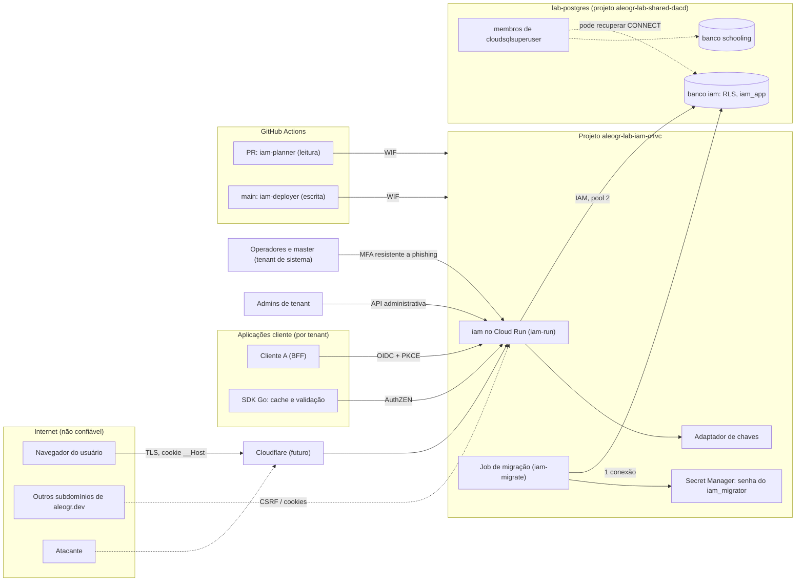

# Modelo de ameaças do iam

## 1. Escopo e status

| Item | Valor |
|---|---|
| Status | **Esboço inicial** (2026-11-06) |
| Escopo | AuthN e AuthZ do design de 2026-11-06 ([design](superpowers/specs/2026-11-06-iam-design.md)), o laboratório do [ADR 0001](adr/0001-lab-hosting.md) e o pipeline de CI |
| Insumos | Design, CLAUDE.md (regras de arquitetura e segurança), ADRs 0001 a 0029, brief (4.6, 4.10, 4.17, 4.19, 4.23, 4.29, 4.35, 5.1), [lições de segurança do estudo de mercado](market-study/summary.md#4-lições-de-segurança-insumo-para-o-threat-model) |
| Revisão | A cada marco, e sempre que um ADR mudar uma fronteira de confiança |
| Regra | Todo documento de design de funcionalidade traz a sua própria seção de ameaças (brief 4.19), que estende este documento; cada ameaça vira teste de abuso que tenta o ataque e verifica a recusa (design, seção 10) |
| Classificação | STRIDE: **S** falsificação, **T** adulteração, **R** repúdio, **I** divulgação, **D** negação de serviço, **E** elevação de privilégio |
| "Pendente" | O design ainda não tem mitigação; a coluna "Marco" diz quando ela precisa ser decidida |

## 2. Ativos

| Ativo | Onde vive | Por que importa |
|---|---|---|
| Credenciais e hashes (senhas Argon2id, passkeys) | Postgres `iam` | Tomada de conta; hashes vazados viram ataque offline |
| Chaves de assinatura (ES256) | Adaptador de chaves, carregadas em memória (design 6) | Forjar qualquer token de qualquer tenant |
| Sessões centrais com fatores carimbados | Postgres; cookie `__Host-` | Sequestro de sessão contorna senha e MFA (ADR 0027) |
| Códigos de autorização e refresh tokens | Postgres, só como hash (brief 4.10) | Emissão de tokens em nome do usuário |
| Relações e políticas de AuthZ | Postgres; cache do SDK | Decidem todo acesso dos clientes; adulteração = acesso indevido |
| Log de auditoria | Postgres, encadeado por hash (ADR 0005) | Prova do que aconteceu; alvo de quem quer apagar rastros |
| Dados pessoais | Postgres | LGPD; no laboratório nunca há dados reais (brief 4.17) |
| Configuração, pisos de segurança e proibições | `shared/config` + banco (ADR 0012) | Rebaixar piso desliga defesas sem alterar código |
| Conta master e operadores | Tenant de sistema (design 5) | Controle total da instalação |
| Pipeline e federação do CI | GitHub Actions → WIF → `iam-planner` / `iam-deployer` | `iam-deployer` é, na prática, dono do projeto GCP (ADR 0001) |
| Segredo do `iam_migrator` | Secret Manager do `aleogr-lab-iam-c4vc` | Dono do schema: altera RLS, tabelas e dados |
| Artefatos de release (imagem, módulos, SBOM) | Registro de containers, tags Go | Comprometimento chega a todos os consumidores (ADR 0028) |

## 3. Atores e fronteiras de confiança

| Ator | Confiança | Observação |
|---|---|---|
| Internet / navegador | Nenhuma | Inclui sites em subdomínios vizinhos de `aleogr.dev`, que são o mesmo *site* para o navegador (brief 4.17) |
| Aplicações cliente (A, B, C) | Limitada ao próprio tenant e às próprias credenciais OAuth | Clientes de teste fictícios (ADR 0002) |
| Administradores de tenant e de organização | Dentro do próprio tenant | Não alcançam o tenant de sistema |
| Operadores e master | Alta, com MFA resistente a phishing | Tenant de sistema, invisível aos tenants |
| CI (GitHub OIDC → GCP) | Planner em qualquer PR; deployer só da `main` | Federação restrita ao id do repositório |
| Instância `lab-postgres` e o inquilino `schooling` | Compartilhada, mesmo dono | `REVOKE CONNECT` + `CONNECTION LIMIT` protegem contra **acidente**, não contra ação deliberada: membros de `cloudsqlsuperuser` podem recuperar o `CONNECT` (aleogr/lab `docs/lab.md`) |
| Cloudflare | Futura (proxy, DNS, Access) | Ainda sem serviço publicado (design 14) |

Fronteiras: (1) internet → serviço; (2) tenant → tenant dentro do serviço; (3) tenant → tenant de sistema; (4) serviço → banco (RLS); (5) inquilino `iam` → inquilino `schooling` na instância; (6) PR → `main` no CI; (7) dependências → binário.

## 4. Ameaças por componente

### 4.1 OIDC e OAuth (`authn/server`)

| ID | Ameaça | STRIDE | Mitigação no design | Teste de abuso | Marco |
|---|---|---|---|---|---|
| TM-OIDC-001 | Token com `alg: none` ou confusão de algoritmo (HS256 com a chave pública) | S, E | Proibição absoluta (ADR 0012); `go-jose` v4 com lista de algoritmos obrigatória, só ES256 (ADR 0010, design 6) | Token `none`, HS256 e algoritmo trocado são recusados pelo servidor e pelo SDK | 1 |
| TM-OIDC-002 | `redirect_uri` manipulada (curinga, prefixo, HTTP, caminho não normalizado) | S, I | Proibição de curingas e de HTTP fora de desenvolvimento (ADR 0012, brief 4.6) | Variações de prefixo, sufixo, maiúsculas, `..`, porta, fragmento e HTTP são recusadas | 1 |
| TM-OIDC-003 | Ausência de `state`, `nonce` ou PKCE; PKCE `plain` | S, T | PKCE S256 sempre, inclusive em clientes confidenciais (design 5, 6); sem implicit e ROPC (ADR 0012) | Pedidos sem PKCE, com `plain`, sem `nonce` e resposta sem `state` no cliente A falham | 1 |
| TM-OIDC-004 | Código de autorização resgatado duas vezes em paralelo | S, E | Uso único com operação atômica no banco (lição Better Auth) | Dois resgates concorrentes: exatamente um sucede, e o reuso revoga os tokens emitidos | 1 |
| TM-OIDC-005 | Família de refresh bifurcada por reuso concorrente | S | Refresh opaco com rotação e detecção de reuso (design 6), guardado como hash | Reuso e corrida entre duas renovações revogam a família inteira | 1 |
| TM-OIDC-006 | Código ou refresh não vinculado ao `client_id` (lição ZITADEL CVE-2026-55672) | S, E | Vínculo código↔cliente↔tenant no armazenamento (C3) | Cliente B troca código e refresh emitidos para A e é recusado | 1 |
| TM-OIDC-007 | Token de um tenant aceito em outro | S, E | Issuer por tenant `/t/<tenant>` (ADR 0007); `tenant_id` em todo dado | Token do tenant X usado em userinfo, AuthZEN e API do tenant Y é recusado | 1 |
| TM-OIDC-008 | JWKS escolhido pelo `iss` não verificado (lição Topaz GHSA-82cq) | S, I | **Pendente**: emissores e JWKS em allowlist por tenant/aplicação no `authz/server` e no SDK; falha de chave nega | Token com `iss` do atacante e discovery próprio é recusado, sem nenhuma busca à URL indicada | 1 |
| TM-OIDC-009 | Vazamento ou roubo da chave de assinatura | S, I | Chaves só no adaptador de chaves e em `shared/crypto` (design 4.3); rotação via JWKS (brief 4.9). **Pendente**: armazenamento da chave no laboratório (KMS ou Secret Manager) e procedimento de rotação de emergência | Primitivas fora de `shared/crypto` falham no `depguard`/`forbidigo` | 1 |

### 4.2 Sessões e cookies

| ID | Ameaça | STRIDE | Mitigação no design | Teste de abuso | Marco |
|---|---|---|---|---|---|
| TM-SESS-001 | Fixação de sessão | S | Teste obrigatório (design 11). **Pendente**: especificar novo identificador de sessão a cada mudança de fator | Identificador definido antes do login deixa de valer depois dele | 1 |
| TM-SESS-002 | CSRF a partir de subdomínio vizinho de `aleogr.dev` (mesmo *site*, `SameSite` não protege) | T, E | Token anti-CSRF e verificação de `Origin` (design 6, brief 4.17) | POST com `Origin` de outro subdomínio, sem `Origin` e sem token é recusado | 1 |
| TM-SESS-003 | Cookie sobrescrito ou lido por subdomínio vizinho (*cookie tossing*) | T, I | Prefixo `__Host-`, `HttpOnly`, `Secure`, sem `Domain` (design 6) | Cookie homônimo com `Domain=.aleogr.dev` não substitui a sessão | 1 |
| TM-SESS-004 | Sessão de outro tenant aceita | S, E | Sessão escopada por tenant (ADR 0007, design 5) | Cookie de sessão do tenant X em `/t/Y/authorize` não autentica | 1 |
| TM-SESS-005 | Sessão elevada reaproveitada para ação sensível (lição Teleport RFD 0131) | E | Fatores carimbados com horário; política exige fatores e frescor (ADR 0027) | Ação que exige fator recente falha com fator antigo | 1 |

### 4.3 Senhas

| ID | Ameaça | STRIDE | Mitigação no design | Teste de abuso | Marco |
|---|---|---|---|---|---|
| TM-PWD-001 | Força bruta online | S | Rate limiting no Postgres (design 9); NIST SP 800-63-4 (ADR 0027) | Tentativas acima do limite são bloqueadas por conta e por IP | 1 |
| TM-PWD-002 | Credential stuffing | S | Checagem de senha vazada por lista local (design 6); passkey como opção | Senha da lista local é recusada no cadastro e na troca | 1 |
| TM-PWD-003 | Argon2id como vetor de DoS (CPU e memória por tentativa) | D | **Pendente**: limite de hashes concorrentes e rate limiting antes do hash, compatíveis com 1 instância e as metas do ADR 0011 | Rajada de logins não derruba o serviço nem passa do limite de memória | 1 |
| TM-PWD-004 | Enumeração de usuários por mensagem ou tempo | I | Teste obrigatório (design 11); comparação em tempo constante (`shared/crypto`). **Pendente**: hash fictício para conta inexistente e mensagens idênticas no cadastro e na recuperação | Conta existente e inexistente: mesma resposta, tempos estatisticamente indistinguíveis | 1 |
| TM-PWD-005 | Truncamento de senha (lição bcrypt 72 bytes) ou importação de hash fraco | S | Argon2id; NIST proíbe truncamento (ADR 0027); nunca bcrypt como KDF genérica. Importação de bcrypt (brief 4.10): **pendente** recusar ou tratar senhas acima de 72 bytes | Duas senhas com os mesmos 72 primeiros bytes são distintas | 1 (importação: posterior) |

### 4.4 Passkeys (WebAuthn)

| ID | Ameaça | STRIDE | Mitigação no design | Teste de abuso | Marco |
|---|---|---|---|---|---|
| TM-PK-001 | Passkey registrada num tenant aceita em outro: o issuer é por caminho e o RP ID (host do AuthN) é o mesmo para todos | S, E | Credencial vinculada ao tenant e recusada em qualquer outro (ADR 0007, design 6) | Asserção válida do tenant X em `/t/Y` é recusada | 1 |
| TM-PK-002 | Origem ou RP ID comparados por sufixo de string (lição webauthn-rs GHSA-22w3) | S | RP ID restrito ao host do AuthN, nunca `aleogr.dev` (brief 4.17); `go-webauthn` fixada e revisada a cada atualização (design 10) | Origens `evil<host>`, `<host>.evil` e subdomínio vizinho são recusadas (comparação por rótulos DNS) | 1 |
| TM-PK-003 | Cadastro de passkey numa conta alheia (lição ZITADEL) | E | Cadastro exige sessão com fatores e frescor (ADR 0027) | Cadastro sem sessão recente ou de outra conta falha | 1 |

### 4.5 Vinculação e recuperação de conta

| ID | Ameaça | STRIDE | Mitigação no design | Teste de abuso | Marco |
|---|---|---|---|---|---|
| TM-ACC-001 | Pre-hijacking: atacante cria a conta com o e-mail da vítima antes dela | S, E | Vincular só com e-mail verificado por IdP confiável (brief 5.1). **Pendente**: regras de vínculo e de cadastro não verificado | Conta criada sem verificação não é vinculada nem herdada pela vítima | posterior (federação) |
| TM-ACC-002 | Recuperação mais fraca que o MFA (lição Okta helpdesk) | S, E | Regra do brief 5.1. **Pendente**: design de recuperação | Recuperação não contorna MFA exigido (brief 4.19) | posterior |
| TM-ACC-003 | Reutilização de códigos de verificação ou OTP | S | Códigos guardados só como hash (brief 4.10). **Pendente**: uso único atômico | Código usado duas vezes ou em corrida falha | posterior |

### 4.6 Multi-tenancy

| ID | Ameaça | STRIDE | Mitigação no design | Teste de abuso | Marco |
|---|---|---|---|---|---|
| TM-TEN-001 | Consulta sem filtro de tenant expõe dados de outro | I, E | Porta de armazenamento exige `TenantID` (design 4.3); RLS como segunda barreira, `iam_app` sem `BYPASSRLS` e sem posse das tabelas (design 9, ADR 0001) | Suíte de contrato entre tenants em toda porta (C3); consulta direta como `iam_app` sem tenant definido retorna vazio | 1 |
| TM-TEN-002 | Credencial de tenant alcança endpoint global (lição FusionAuth, SuperTokens) | E | Tenant de sistema invisível (design 5); papéis administrativos no RBAC do AuthZ (design 7.5). **Pendente**: matriz endpoint × escopo gerada da API Protobuf | Toda rota da API administrativa e do AuthZEN é chamada com credencial de cada tenant e de cada papel | 1 |
| TM-TEN-003 | Administrador de tenant rebaixa piso de segurança herdado | E, T | Pisos que níveis inferiores não rebaixam; modo estrito; proibições (design 5, ADR 0012) | Configuração abaixo do piso é recusada na carga e pela API | 1 |
| TM-TEN-004 | Ação administrativa sem rastro ou com log adulterado | R, T | Log somente de inclusão encadeado por hash (ADR 0005); esquema versionado (C4) | Alterar ou apagar evento quebra a verificação da cadeia | 1 |

### 4.7 Motor de AuthZ (`authz/core`, `authz/server`, SDK)

| ID | Ameaça | STRIDE | Mitigação no design | Teste de abuso | Marco |
|---|---|---|---|---|---|
| TM-AZ-001 | Decisão inconsistente com os dados (revogação ainda não vista; cache vencido) | E | Cache com TTL curto configurável (ADR 0017); tokens de consistência para revogações sensíveis (ADR 0016) | Após revogação com token de consistência, nenhum check posterior permite | 1 (cache), 2 (tokens) |
| TM-AZ-002 | Listagem mais permissiva que o check (lição Cerbos, SpiceDB); lote checando só o 1º recurso (lição Keycloak) | E, I | Listagem nunca mais permissiva que o check, nunca trunca (ADR 0018); testes de propriedade check × lote × listagem (design 7.1) | Propriedade: todo item listado e todo item do lote coincide com o check individual | 1 (lote), 2 (listagem) |
| TM-AZ-003 | Fail-open por erro no meio da avaliação (lição OpenFGA GHSA-5278) | E | Fail-closed em qualquer erro (design 7.1) | Falha de banco ou contexto ausente no meio da avaliação nega (design 11) | 1 |
| TM-AZ-004 | DoS por política maliciosa no parser ou avaliador (lição Cedar GHSA-m84h) | D | Núcleo Cedar sem laços, regex nem ponto flutuante (ADR 0015); fuzzing com limites de tamanho e profundidade (design 7.1) | Políticas profundas ou enormes são recusadas na validação, sem estourar memória | 1 |
| TM-AZ-005 | Divergência entre representação JSON e texto (lição Cedar GHSA-c33x) | E | JSON com a mesma validação do texto; testes diferenciais contra `cedar-go` (ADR 0014, 0015) | Corpus diferencial: texto, JSON e oráculo dão a mesma decisão | 1 |
| TM-AZ-006 | Acesso entre tenants por políticas ou relações | E, I | `tenant_id` em toda relação e política; porta exige `TenantID` | Relação ou política do tenant X nunca influencia decisão no Y | 1 |
| TM-AZ-007 | PDP indisponível vira permissão | E, D | SDK usa cache dentro do TTL e depois nega (ADR 0017) | PDP fora do ar além do TTL: SDK nega | 1 |
| TM-AZ-008 | Explicação da decisão vaza política ou dados | I | Detalhe só para administração (ADR 0019) | Chamador sem papel administrativo recebe só permitir/negar | 1 |
| TM-AZ-009 | Abuso de delegação (delegar mais do que tem, sem prazo, em cadeia) | E | Delegação só de subconjunto, com prazo (ADR 0020); token exchange (ADR 0023) | Delegação de permissão não possuída ou sem prazo é recusada | posterior |
| TM-AZ-010 | Acesso temporário usado após a expiração | E | Relações com validade (ADR 0020); relógio do servidor injetado (design 4.3) | Relação vencida nega mesmo com cache e outbox atrasados | 2 |
| TM-AZ-011 | Hora fornecida pelo cliente decide acesso (lição Keycloak) | T, E | Relógio só do servidor, injetado (design 4.3); nunca confiar em hora enviada pelo cliente (CLAUDE.md) | Pedido com hora forjada no contexto não muda a decisão temporal | 1 |
| TM-AZ-012 | Obrigação ignorada pela aplicação | E | Aplicação que não entende a obrigação nega (ADR 0020) | SDK com obrigação desconhecida nega | posterior |
| TM-AZ-013 | Transição de estado ilegal | T, E | Estados e transições declarativos com guards (ADR 0022, C5) | Teste baseado em modelo: toda transição inválida é recusada (brief 4.19) | 1 (login), posterior (AuthZ) |

### 4.8 Aprovação M de N (ADR 0021)

| ID | Ameaça | STRIDE | Mitigação no design | Teste de abuso | Marco |
|---|---|---|---|---|---|
| TM-MN-001 | Autoaprovação | E | Quórum por papéis; solicitante não aprova; separação de funções e conflito de interesse verificados por política, como exige o perfil AuthZEN (ADR 0021) | Solicitante não conta no quórum | posterior |
| TM-MN-002 | Mesma pessoa aprovando duas vezes (duas credenciais ou duas contas) | E | Quórum contado por pessoa distinta, não por chave (ADR 0021) | Duas assinaturas da mesma pessoa contam uma | posterior |
| TM-MN-003 | Aprovação reaproveitada para outra ação | E | Assinatura WebAuthn sobre o hash da ação canônica RFC 8785 com nonce; janela de tempo e expiração; aprovação não vale para outra ação nem para a mesma ação alterada (ADR 0021) | Assinatura sobre ação A não autoriza B nem uma segunda execução de A | posterior |
| TM-MN-004 | Ação trocada depois da aprovação | T | Execução por reavaliação ou pacote de evidências verificável pelo executor (ADR 0021) | Alterar qualquer campo da ação invalida o pacote | posterior |
| TM-MN-005 | Aprovador vê uma ação e assina outra (WebAuthn não prova o que foi exibido) | S, T | UI própria exibe a forma canônica; sem promessa de "what you see is what you sign" (differentials-check). Risco aceito (seção 5) | UI renderiza exatamente o hash assinado (teste de UI) | posterior |

### 4.9 Administração, master e operadores

| ID | Ameaça | STRIDE | Mitigação no design | Teste de abuso | Marco |
|---|---|---|---|---|---|
| TM-ADM-001 | Reutilização do token de inicialização do master | E | Token de uso único que se desativa e não se reativa remotamente (design 6, brief 4.23) | Segundo uso e uso concorrente falham | 1 |
| TM-ADM-002 | Master sem MFA resistente a phishing | S | Proibição absoluta (ADR 0012) | Configuração sem MFA resistente a phishing é recusada | 1 |
| TM-ADM-003 | Escalada de administrador de tenant para operador ou master | E | Tenant de sistema invisível e inalcançável (design 5); RBAC administrativo (design 7.5) | Administrador de tenant tenta criar operador, ler o tenant de sistema e mudar a própria função (design 11) | 1 |
| TM-ADM-004 | Impersonação pelo suporte sem rastro | R, E | Impersonação sempre auditada, com ator e representado (brief 4.11, 5.1). **Pendente**: design da impersonação | Toda ação impersonada gera evento com os dois sujeitos | posterior |
| TM-ADM-005 | Sessão roubada do único operador executa ação crítica | E | Fatores com frescor (ADR 0027). **Pendente**: atraso com janela de cancelamento e notificação (brief 4.23) | Ação crítica fica pendente durante a janela | posterior |

### 4.10 Parsers e limites de entrada

| ID | Ameaça | STRIDE | Mitigação no design | Teste de abuso | Marco |
|---|---|---|---|---|---|
| TM-PARSE-001 | DoS em JOSE (go-jose 2026: JSON aninhado, CBC-HMAC, RSA sem limites, CVE-2025-27144) | D | `go-jose` ≥ 4.1.8 (ADR 0010); só JWS ES256 (design 6); fuzzing (design 11) | Tokens enormes, aninhados e com JWE são recusados antes do parse | 1 |
| TM-PARSE-002 | Corpo de requisição enorme ou profundamente aninhado (Protobuf, JSON do AuthZEN) | D | Limites de tamanho e profundidade em toda entrada analisada (CLAUDE.md); valores na configuração tipada (C1) | Corpos acima do limite falham com erro, sem alocação proporcional | 1 |
| TM-PARSE-003 | JSON sem distinção de maiúsculas ou campos duplicados (lição Pomerium) | T, E | Parser canônico estrito, falhar fechado (lição de mercado). **Pendente**: escolha do decodificador estrito | `{"Sub":..}` e chave duplicada são recusados | 1 |
| TM-PARSE-004 | Caminho não normalizado casa regra mais ampla (lição Keycloak, oauth2-proxy) | E | **Pendente**: normalização única de caminho antes do roteamento por tenant | `/t/X/../Y`, `%2f` e barras duplas não mudam o tenant | 1 |
| TM-PARSE-005 | Parsers recursivos de federação (SAML, SCIM, LDAP; lição Kanidm, Authentik) | D, S | **Pendente**: parser auditado, replay cache, testes XSW (brief 4.19) | XSW, comentário no NameID e replay são recusados | posterior |

### 4.11 Cadeia de suprimentos e CI

| ID | Ameaça | STRIDE | Mitigação no design | Teste de abuso | Marco |
|---|---|---|---|---|---|
| TM-CI-001 | Action comprometida por tag móvel | T, E | Actions fixadas por SHA completo e actions de terceiros só da allowlist (brief 4.18, CLAUDE.md); `actionlint` (design 11) | Check que falha com action sem hash | 0 |
| TM-CI-002 | `GITHUB_TOKEN` com permissões amplas | E | **Pendente**: `permissions:` mínimo por workflow e por job | Check que falha em workflow sem `permissions` explícito | 0 |
| TM-CI-003 | PR aplica Terraform a partir da própria branch | E | Planner só leitura em PRs; deployer só da `main`; WIF restrita ao id do repositório (ADR 0001) | Federação recusa `iam-deployer` fora da `main` (verificação manual registrada) | 0 |
| TM-CI-004 | Dependência maliciosa ou vulnerável | T, E | Política de dependências com lista fechada (design 10); `govulncheck`, licenças, varredura de imagem (design 11) | Dependência nova sem justificativa falha no CI | 0 |
| TM-CI-005 | Artefato adulterado entre build e consumidor | T | SBOM, assinatura e proveniência antes de release (design 11, ADR 0028) | Publicação falha sem SBOM e assinatura válidos (brief 4.18) | 0 (SBOM), posterior (assinatura) |
| TM-CI-006 | Auto-merge leva mudança sensível sem revisão humana | T, E | Auto-merge só fora das áreas sensíveis, após checks (design 12); revisor que não escreveu o código (design 11); áreas sensíveis listadas no CLAUDE.md, com merge só pelo dono | PR que toca área sensível não entra em auto-merge | 0 |
| TM-CI-007 | Vulnerabilidade reportada em público | I | `SECURITY.md` com canal privado; obrigações do CRA (ADR 0028) | — | 0 |

### 4.12 Segredos e padrões

| ID | Ameaça | STRIDE | Mitigação no design | Teste de abuso | Marco |
|---|---|---|---|---|---|
| TM-SEC-001 | Segredo padrão no código (lição Kratos, Keto) | S, E | Nenhuma credencial padrão (brief 4.23, ADR 0012); `gitleaks` (design 11) | Servidor não inicia sem segredos configurados | 0 |
| TM-SEC-002 | Senha do `iam_migrator` no state do Terraform ou no repositório | I, E | Gerada no Secret Manager; usuário criado à mão e importado; o Terraform nunca conhece a senha (ADR 0001) | Busca da senha no state e no histórico (verificação manual) | 0 |
| TM-SEC-003 | Segredo de banco de longa duração no serviço | I | Serviço entra como usuário IAM `iam-run`, sem senha (ADR 0001) | — | 1 |
| TM-SEC-004 | Cursor ou token forjado (lição Keto: SQLi via cursor) | T, E | Cursores e tokens autenticados (lição de mercado). **Pendente**: formato do cursor da API administrativa | Cursor alterado é recusado | 1 |
| TM-SEC-005 | Senha ou token em logs | I | Logs nunca contêm tokens, segredos, senhas nem dados pessoais brutos (brief 4.23, CLAUDE.md) | Log de um fluxo completo não contém senha, código, refresh nem cookie | 1 |

### 4.13 Instância compartilhada do laboratório

| ID | Ameaça | STRIDE | Mitigação no design | Teste de abuso | Marco |
|---|---|---|---|---|---|
| TM-LAB-001 | Restore da instância inteira afeta o `schooling` (e vice-versa) | D, T | Nenhuma; risco aceito (ADR 0001) | — | 1 |
| TM-LAB-002 | Membro de `cloudsqlsuperuser` recupera `CONNECT` no banco `iam` | I, T | `REVOKE CONNECT FROM PUBLIC`, grant por nome; protege só contra acidente (ADR 0001, aleogr/lab). Risco aceito | — | 1 |
| TM-LAB-003 | Esgotamento de conexões derruba o iam ou o vizinho | D | `CONNECTION LIMIT 6`; pool 2; sem `LISTEN/NOTIFY`; pool esgotado espera, nunca abre conexão extra; constante de orçamento com teste (ADR 0001, design 9) | Teste que falha se a soma passar de 6; carga com pool esgotado não abre a 7ª conexão | 1 |
| TM-LAB-004 | iam toca banco, usuário ou role de outro inquilino | E | `sqlTenant` não isola; o iam só toca `iam`/`iam_*` (ADR 0001) | Revisão do plano do Terraform no PR | 0 |
| TM-LAB-005 | Dados pessoais reais no laboratório | I | Nunca usar dados reais no lab (brief 4.17); clientes fictícios (ADR 0002) | — | 1 |

### 4.14 SDKs, artefatos e borda

| ID | Ameaça | STRIDE | Mitigação no design | Teste de abuso | Marco |
|---|---|---|---|---|---|
| TM-SDK-001 | Resposta de autenticação em cache de CDN servida a outro usuário (lição WorkOS) | I | `Cache-Control: no-store` (design 6); nenhuma regra de cache da Cloudflare nesses caminhos (brief 4.17) | Toda resposta de `/authorize`, `/token`, `/userinfo`, login e sessão tem `no-store` | 1 (cabeçalho), posterior (Cloudflare) |
| TM-SDK-002 | Token no HTML, em log do SDK ou em HAR (lições WorkOS, Okta) | I | SDK testado como código crítico (lição de mercado); BFF no cliente A (design 4.4); regra de logs do TM-SEC-005 vale para o SDK | Logs do SDK e HTML do cliente A não contêm tokens | 1 |
| TM-SDK-003 | Predicado de autorização mal aplicado pelo SDK (lição Clerk) | E | SDK com cache de decisões, testado contra o PDP (design 7.5) | Testes de contrato C7 do SDK × servidor | 1 |
| TM-SDK-004 | IP falsificado via `CF-Connecting-IP` contorna rate limiting e auditoria | S, R | Aceitar o cabeçalho só de requisições vindas da Cloudflare (brief 4.17) | Cabeçalho vindo de fora da Cloudflare é ignorado | posterior |
| TM-SDK-005 | Tomada de subdomínio de projeto desativado | S | Remover registros DNS de projetos desativados (brief 4.17) | — | posterior |
| TM-SDK-006 | Painel administrativo exposto à internet | E | Cloudflare Access (design 14, brief 4.23) | — | posterior |

## 5. Riscos aceitos

| Risco | Motivo | Revisitar |
|---|---|---|
| O laboratório compartilha a instância com o `schooling`; restore e indisponibilidade afetam os dois | Custo mínimo sem receita (premissa 17, ADR 0001) | Ao sair do laboratório (o iam sai do `lab-postgres` em produção) |
| `sqlTenant` e `REVOKE CONNECT` não isolam inquilinos; `cloudsqlsuperuser` recupera o acesso | Mesmo dono nos dois inquilinos; proteção contra acidente basta no lab | Idem |
| `iam-deployer` é, na prática, dono do projeto GCP | Precisa de `projectIamAdmin`; alcançável só pela `main`, com branch protegida | A cada mudança de CI |
| WebAuthn não prova o que o autenticador exibiu (M de N) | `txAuth*` nunca implementadas nos navegadores; a ação depende da nossa UI | Se a proposta w3c/webauthn#2022 avançar |
| Laboratório indisponível à noite (seg–qui) | Instância dorme para custo | Estágio 1 |
| Passkeys do lab presas ao RP ID do lab | Domínio definitivo ainda não existe (brief 4.17) | Antes de usuários reais |
| Chaves de assinatura em memória, não em KMS/HSM | Latência e custo; configurável (brief 4.9) | Antes de produção |
| Nenhuma lib Go de identidade tem auditoria independente publicada | Dependências mínimas e fixadas; fuzzing próprio | Auditoria externa (seção 6) |

## 6. Próximos passos

| Passo | Quando |
|---|---|
| Decidir cada item "pendente" no marco indicado e mover a ameaça para "mitigada" com link ao teste | Marcos 0 e 1 |
| Seção de ameaças em cada design de funcionalidade, citando os Cheat Sheets OWASP (brief 4.19, 4.35) | Cada design |
| Agente "atacante" sem autoria do código nas áreas sensíveis (design 11) | Marco 1 |
| Matriz de rastreabilidade ASVS nível 3 → teste (brief 4.35); Top 10 de CI/CD no pipeline | Marco 1 em diante |
| Varredura dinâmica (ZAP) contra instâncias no CI | Posterior |
| Auditorias externas antes de produção com dados reais: camada criptográfica, tokens, recuperação de conta, SAML, avaliação de políticas, M de N | Antes de produção |
| Revisão deste documento | A cada marco |
